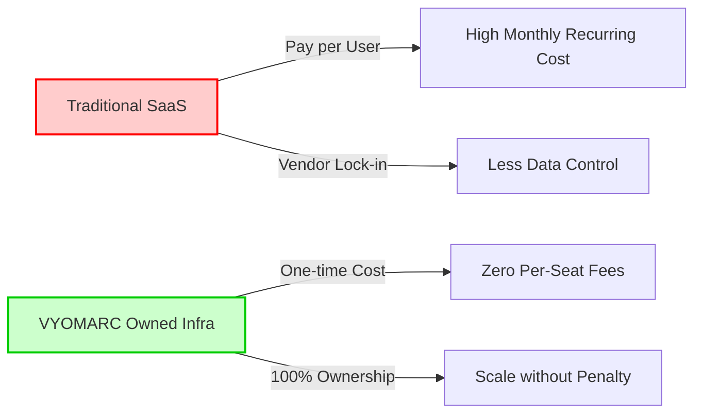

  

---

> **Quick Take:** The traditional "per-seat" SaaS billing model is broken. Charging companies every time they hire an employee turns software into a direct tax on growth. In response, smart businesses across Patna, Bihar Sharif, and Tier-2 India are rejecting vendor rent-seeking and switching to **Custom Owned Infrastructure**—paying once for custom engineering, keeping 100% data control, and scaling without headcount penalties.

---

Imagine this scenario: You run a busy healthcare clinic or diagnostic center. 

You started two years ago with two receptionists using an off-the-shelf patient management tool at ₹2,500 per user per month. Your clinic grew. You hired three more front-desk assistants to handle the patient rush. 

The software did not change. The database did not require extra server horsepower. The features remained identical. Yet your monthly software invoice suddenly jumped from ₹5,000 to ₹12,500 every single month.

Does that feel like fair billing? Or does it feel like a penalty for creating local jobs?

This is the reality facing thousands of business owners across Bihar and across India. The software industry sold everyone on the dream of "affordable cloud subscriptions." But as companies grow, the math flips. You end up renting your own daily workflow from a distant corporate landlord who raises rates every quarter.

The backlash has arrived. Business owners are pushing back, and the per-seat model is rapidly losing its grip.

---

## The Core Issue — Software that Punishes Success

The per-user pricing model made sense twenty years ago. Back when software arrived on CDs and enterprise sales reps installed physical licenses on specific desktop machines, vendors charged per workstation. 

When cloud computing took over, SaaS vendors kept the per-seat model for one reason: **it guaranteed compounding recurring revenue for their investors.**

Here is the dirty secret of modern web applications: a database query from User #1 costs the cloud provider fractions of a paisa. When User #5 runs the exact same query, the infrastructure cost is virtually zero. 

Yet SaaS vendors charge you 5x the price.

This creates toxic operational behavior inside growing companies:
* Managers start sharing login credentials to avoid buying another $30/month seat.
* Security goes out the window as multiple employees pass around one master password.
* Junior staff get locked out of systems where they could be productive, simply to keep the monthly software bill from exploding.

When your software pricing model forces you to restrict your own team from using operational tools, the model is bankrupt. It punishes success and taxes company expansion.

---

## The Rise of Outcome-Based Pricing

Businesses do not care about "seats." You do not wake up in the morning wanting to buy five logins to a web portal. 

You want outcomes:
* You want patient records fetched in under two seconds.
* You want invoices generated and synced to WhatsApp automatically.
* You want stock inventory updated without human error.

The global tech market is already waking up to this reality. Leading enterprises are walking away from bloated per-seat contracts and demanding outcome-based models, flat infrastructure fees, or custom owned builds.

Why should a logistics operator pay per driver login when they could run a lightweight, custom-built dispatch server that handles 50,000 deliveries a month for a flat monthly server cost of ₹1,200?

When you decouple pricing from headcount, your software returns to what it was always meant to be: leverage, not overhead.

---

---

## The AI Factor (Why Human Count is Obsolete)

If the per-seat model was already on shaky ground, artificial intelligence just pushed it off the cliff.

Consider what modern software actually does today. Automated background workers reconcile invoices. AI agents classify inbound customer inquiries. Bots trigger WhatsApp dispatch notifications. Scripts generate daily sales ledgers while your staff sleeps.

None of this work is done by a human sitting in front of a screen clicking a button. 

So who is the "seat" you are paying for?

If an automated pipeline handles the workload of three data-entry clerks, should you pay the SaaS vendor for three imaginary human seats? Of course not. Charging per human user in an era of automated, agentic workflows is pure commercial nonsense. 

The economic value of software lives entirely in the automation and the underlying database—not the number of chairs in your office.

---

## The Tier-2 & Tier-3 Reality

In high-margin Silicon Valley startups or Mumbai corporate offices, throwing ₹80,000 a month on SaaS subscriptions often gets written off as a routine operating expense.

In regional commercial centers like Bihar Sharif, Patna, Muzaffarpur, and Gaya, every rupee must generate a tangible return on investment.

Local business owners operate in competitive, cash-flow-conscious markets:
1. **Zero Tolerance for Dollar Rent:** Paying monthly fees that increase with currency fluctuations or arbitrary price hikes eats directly into retail and manufacturing margins.
2. **Data Sovereignty Matters:** A hospital or wholesale distributor cannot afford to have their customer database locked behind an expired subscription paywall.
3. **Long-Term Asset Value:** Local entrepreneurs understand real estate and machinery. You buy an asset, maintain it, and run it for years. Renting operational software forever feels like throwing money down a bottomless pit.

Regional business leaders want **Custom Owned Infrastructure**. They want a platform engineered specifically for their operational workflow, deployed on their private cloud server, with full source code ownership. Pay once for the engineering, own the asset forever.

---

## The VYOMARC Approach (The Pitch)

At VYOMARC Technologies, we took a clear look at how traditional SaaS companies treat local businesses, and we decided to build the exact opposite model.

**We don't charge you per-user like greedy SaaS companies. We build your system, you own it. Zero per-seat fees, zero vendor lock-in. You pay once for the engineering, and the system scales with your business.**

Here is what owned infrastructure looks like in practice:
* **100% Source Code & Database Ownership:** All codebase repositories, server access credentials, and databases belong strictly to your company from Day One.
* **Unlimited Team Members:** Whether you have 3 staff members today or 300 next year, your system cost remains the same. Add as many users, roles, and branch offices as you need.
* **Direct Server Economics:** You host your application on your own secure cloud instance (AWS, DigitalOcean, or Hostinger). A production web system capable of serving thousands of daily active users often runs on less than ₹1,500/month in raw hosting.
* **Tailored to Your Workflow:** No bloat, no confusing features built for someone else, and no forced updates that break your daily routine.

---

## Take Back Control of Your Tech Stack

Take an honest look at your bank statements from the last twelve months. Add up the monthly fees for your CRM, your appointment booking tool, your billing portal, and your team communication apps. 

Multiply that number across the next five years. Now factor in what happens when you double your team size.

The math is alarming. You are pouring capital into renting someone else's software while building zero enterprise equity for your own firm.

Software should empower your team to hire fearlessly, not force you to count user licenses before posting a job opening.

If you are ready to stop paying the growth tax, read our comprehensive guide on [How to Choose the Best Software Company](how-to-choose-software-development-company-bihar-patna.html) to evaluate engineering partners who build assets you actually own.

Ready to audit your SaaS stack and transition to owned infrastructure? [Schedule a consultation with our engineering team](../../contactus.html) and let us design a custom system built to scale with your business.
