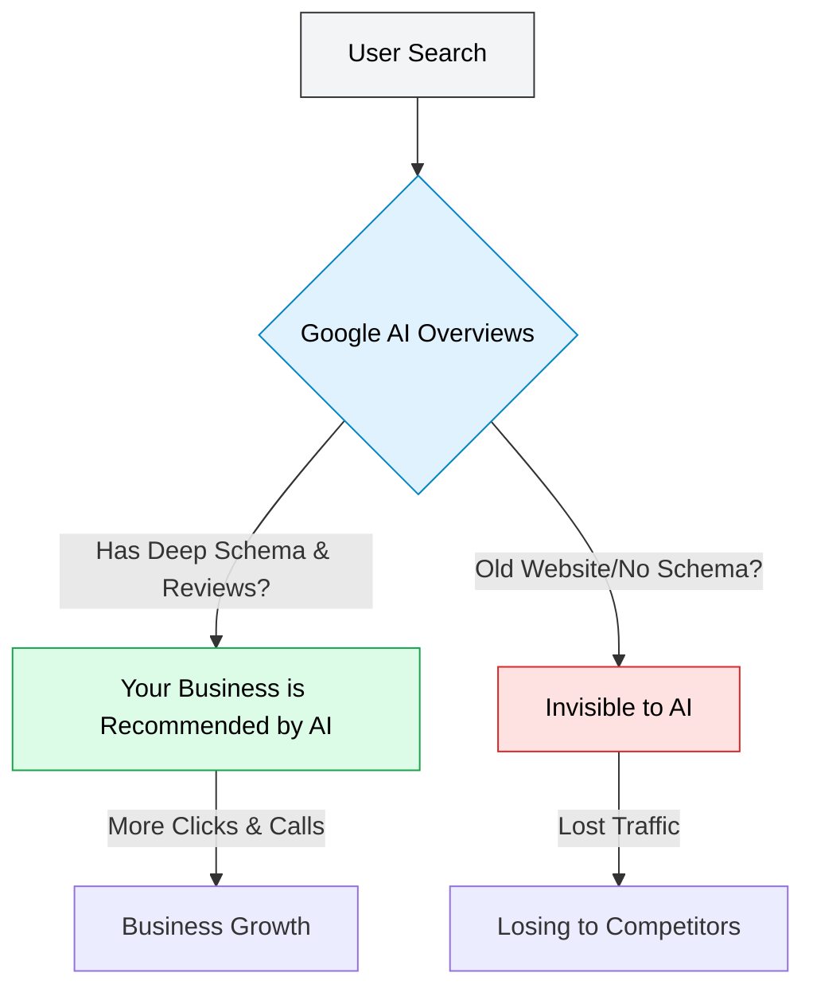

  

---

> **Quick Take:** Traditional search engine optimization is experiencing its biggest disruption in twenty years. With Google AI Overviews answering commercial queries directly at the top of the screen, old tactics like keyword stuffing and generic directory links no longer drive phone calls. Local businesses in Patna, Bihar Sharif, and across India must shift immediately to machine-readable JSON-LD schema, review sentiment optimization, and sub-second page performance—or disappear from search results entirely.

---

When was the last time you clicked on the 4th link on Google?

Be honest. You probably can't remember.

In fact, most people don't even scroll down to the first organic link anymore. When someone opens Google today on their phone, an **AI Overview** occupies the entire visible viewport. It synthesizes information, compares local options, cites three specific businesses, and answers the user's question before they ever touch their screen to scroll.

If Google's AI model does not extract your business as one of its cited sources, your website might as well not exist.

The rules of customer discovery have been rewritten overnight. If your company still depends on marketing strategies designed in 2018, you are quietly bleeding qualified leads to competitors who understand the new search ecosystem.

---

## The Death of the "10 Blue Links"

For two decades, search optimization followed a predictable formula: pack target keywords into title tags, get listed in five local business directories, and wait for your page to land on the first page of ten blue links.

That playbook is dead.

Today, when a patient in Patna searches *"Best orthopedic clinic with emergency fracture care"*, Google does not show ten links to hospital homepages. The search engine generates a consolidated AI panel:
* It extracts specific doctor credentials.
* It checks real-time operating hours.
* It summarizes patient feedback on waiting times.
* It places a direct click-to-call button directly inside the AI answer box.

Businesses that failed to adapt are watching their organic clicks collapse by 40% to 60%, even while their old rankings look intact on traditional reports. Ranking #3 doesn't help you when the AI Overview pushes the #3 organic link 1,200 pixels below the fold.

If you aren't feeding Google's generative engine the exact structured facts it craves, you are completely bypassed.

---

## The Schema Mandatory Rule (The New SEO)

How does Google's generative algorithm decide which local company to recommend?

It does not read your website like a human browsing a magazine. It parses code through automated machine crawlers. If your site is built with plain HTML tags, bloated visual builders, or unindexed scripts, the AI scanner moves on to the next competitor.

To get cited by AI Overviews, **Deep Structured Schema Markup (JSON-LD)** is mandatory.

Your website must explicitly declare structured entity data:
* **LocalBusiness & MedicalBusiness Entities:** Telling the bot exactly who owns the business, verified registration IDs, latitude/longitude coordinates, and precise departmental hours.
* **Service Catalogs & Real Pricing:** Linking exact procedures or products directly to structured price ranges so AI engines can answer cost-related buyer queries.
* **Founder & Leadership Schema:** Proving authentic real-world engineering and domain expertise so your business satisfies strict search credibility filters.

Without clean, validated JSON-LD schema powering your pages, Google's AI treats your business as an unverified rumor.

---

---

## Reviews as the New Ranking Currency

Backlinks used to be the primary currency of web authority. While domain authority still matters, generative AI has elevated a far more powerful ranking signal: **Customer Review Sentiment**.

Google's Large Language Models (LLMs) continuously read, categorize, and evaluate reviews left on your [Google Business Profile](google-par-business-kaise-dalen-google-my-business.html), Justdial, and social accounts. *(If you haven't properly set up or optimized your listing yet, follow our practical guide on [गूगल पर अपना बिज़नेस कैसे दर्ज करें (Google My Business Guide)](google-par-business-kaise-dalen-google-my-business.html)).* 

The AI does not just count star ratings; it analyzes semantic meaning:
* Does the reviewer mention specific service names (e.g., *"custom ERP software"*, *"root canal treatment"*, *"rapid billing"*)?
* Is the sentiment around staff responsiveness and pricing consistently positive?
* Does the business owner respond promptly with professional, factual answers?

A local shop with twenty in-depth reviews detailing specific customer problems and successful outcomes will consistently outrank a competitor with one hundred generic five-star ratings that have no text. Real human sentiment is now an active algorithmic ranking factor.

---

## Load Speed as the AI Trigger

Here is a technical truth most marketing agencies hide: **AI crawlers have strict compute budgets.**

When Google's bot crawls web pages to construct real-time search syntheses, it gives your server milliseconds to respond. If your website takes more than 3 seconds to complete its initial paint, the AI crawler aborts the extraction and pulls facts from a faster competitor instead.

This is why Progressive Web Apps (PWAs) and ultra-clean static codebases are dominating modern search visibility:
1. **Instant First Contentful Paint:** Delivering essential text and schema markup in under 800 milliseconds.
2. **Zero Bloat:** Eliminating 40 unneeded WordPress plugins and third-party tracking scripts that choke mobile processors.
3. **Core Web Vitals Compliance:** Ensuring zero layout shifting while buttons and inquiry forms respond instantly.

Speed is no longer just a user experience luxury. It is the gatekeeper that determines whether Google's AI gives your website a seat at the table.

---

## The Hard Truth for Bihar Businesses

Let's address the regional reality directly.

That five-year-old static website built on outdated templates back in 2020? The one that takes seven seconds to load on a mobile phone in Patna or Bihar Sharif? 

**It will not show up on Google Maps or AI search summaries in 2026.**

Across Patna, Gaya, Muzaffarpur, and Nalanda, regional commerce is consolidating rapidly. The clinics, diagnostic centers, schools, and retail suppliers winning the market are not spending fortunes on billboards. They are capturing the high-intent buyer who pulls out a phone, types a search, and acts on Google's immediate AI recommendation.

When you invest in digital assets, you cannot afford to build yesterday's technology. You need engineering that actively anticipates where search algorithms are heading.

---

## How VYOMARC Future-Proofs Your Website

At VYOMARC Technologies, we designed our engineering architecture specifically to conquer this new AI reality.

**We don't just build websites; we build AI-ready digital assets. From strict schema markup and PWA architecture to Google Business Profile optimization, we ensure your business gets picked up by AI overviews.**

Here is what our AI-readiness engineering delivers:
* **Flawless JSON-LD Schema Integration:** Every page is structured with verified entity tags, FAQ schemas, geographic breadcrumbs, and service catalogs validated against Google's Structured Data testing tools.
* **Sub-Second Performance Engineering:** We handcraft clean, high-performance web systems that load in under 1.2 seconds, keeping your crawl budget maximized and bounce rates near zero.
* **Owned Infrastructure Economics:** You own your code, your hosting, and your data with zero recurring vendor rent-seeking—as we explored in our breakdown of [The Death of "Per-Seat" SaaS Pricing](death-of-per-seat-saas-pricing.html).
* **Transparent Technical Benchmarks:** Learn how to vet development partners systematically before signing an agreement by reading our authoritative guide on [How to Choose the Best Software Company](how-to-choose-software-development-company-bihar-patna.html).

---

## Claim Your Free AI-Readiness Audit

Open a new browser tab right now. Search for your core business service in your city.

Does your business appear in the AI Overview summary? Does Google cite your phone number and address, or is the search engine directing customers straight to your nearest competitor?

If your website isn't structured for AI search, you are operating with an invisible storefront.

Ready to audit your code, fix your structured schema, and dominate local search rankings? [Schedule a free consultation with our engineering team](../../contactus.html) and claim your comprehensive AI-Readiness Audit today.
