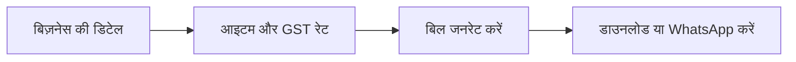

  

---

> **त्वरित सारांश (Quick Summary):** हर महीने हाथ से कागज़ की पर्चियों पर कच्चा बिल काटना, GST का प्रतिशत कैलकुलेटर पर जोड़ना और फिर CA या अकाउंटेंट के चक्कर लगाना छोटे व्यापारियों का बहुत सारा समय और पैसा बर्बाद करता है। डिजिटल बिलिंग से न केवल हिसाब साफ रहता है, बल्कि ग्राहकों का भरोसा भी कई गुना बढ़ जाता है। VYOMARC का नया फ्री GST इनवॉइस टूल आपको बिना किसी सॉफ्टवेयर चार्ज के 60 सेकंड में बिल बनाने की सुविधा देता है।

---

अगर आप बिहार या भारत के किसी भी शहर में किराना स्टोर, हार्डवेयर दुकान, कपड़ों का शोरूम, इलेक्ट्रॉनिक शॉप या सर्विस सेंटर चलाते हैं, तो आपने यह समस्या ज़रूर देखी होगी:

कागज़ की बिल बुक पर हाथ से लिखना, फिर कैलकुलेटर लेकर 5%, 12% या 18% GST अलग से जोड़ना। कई बार जल्दबाज़ी में जोड़-घटाव में गलती हो जाती है, जिससे महीने के अंत में टैक्स रिटर्न भरने के समय बड़ा सिरदर्द खड़ा हो जाता है।

इसके अलावा, आज के दौर में जब ग्राहक को हाथ से लिखा कच्चा पर्चा मिलता है, तो वह उतना प्रोफेशनल नहीं लगता। महंगे ERP और बिलिंग सॉफ्टवेयर हर महीने ₹500 से ₹1,500 का रेंट मांगते हैं, जो एक छोटे दुकानदार के लिए गैर-ज़रूरी बोझ है।

---

## GST इनवॉइस क्या होता है? (What is a GST Invoice?)

सरल शब्दों में, GST इनवॉइस एक आधिकारिक बिल (Official Tax Invoice) होता है जो किसी सामान या सर्विस की बिक्री पर ग्राहक को जारी किया जाता है। 

एक वैध और सही GST इनवॉइस में ये ज़रूरी बातें होनी चाहिए:
* **दुकानदार का विवरण:** आपके बिज़नेस का नाम, पूरा पता और 15 अंकों का मान्य GSTIN नंबर।
* **ग्राहक का विवरण:** ग्राहक या खरीदार का नाम, फोन नंबर और पता।
* **बिल नंबर और तारीख:** हर बिल का एक यूनिक सीरियल नंबर और जारी करने की तारीख।
* **सामान का विवरण:** प्रोडक्ट का नाम, मात्रा (Quantity), प्रति पीस रेट और लागू GST स्लैब (0%, 5%, 12%, 18% या 28%)।
* **टैक्स का साफ़ विभाजन:** कुल बेस अमाउंट, टैक्स की रकम (CGST + SGST या IGST) और फाइनल ग्रैंड टोटल।

---

---

## VYOMARC का फ्री GST इनवॉइस जेनरेटर

छोटे व्यापारियों की इसी परेशानी को दूर करने के लिए हमने बनाया है: **फ्री GST इनवॉइस जेनरेटर टूल**।

आपको कोई भी महंगा सॉफ्टवेयर खरीदने या इंस्टॉल करने की बिल्कुल ज़रूरत नहीं है। अपनी दुकान का नाम, आइटम और रेट डालें, और प्रोफेशनल बिल डाउनलोड करें।

👉 **[फ्री GST इनवॉइस जेनरेटर टूल इस्तेमाल करें](/tools/gst-invoice-generator/index.html)**

यह टूल पूरी तरह से ब्राउज़र में चलता है, जिसका मतलब है कि आपका कस्टमर डेटा आपके डिवाइस पर ही सुरक्षित रहता है।

---

## टूल कैसे इस्तेमाल करें? (How to Use in 3 Steps)

यह टूल इतना आसान है कि कोई भी दुकानदार इसे बिना किसी ट्रेनिंग के 1 मिनट में इस्तेमाल कर सकता है:

1. **स्टेप 1: अपनी दुकान और ग्राहक की जानकारी भरें:** अपनी फर्म का नाम, GSTIN, मोबाइल नंबर और ग्राहक का नाम दर्ज करें।
2. **स्टेप 2: सामान जोड़ें और GST रेट चुनें:** प्रोडक्ट का नाम, क्वांटिटी, रेट और लागू टैक्स स्लैब चुनें। टूल ऑटोमैटिकली बिना किसी गलती के कुल टैक्स जोड़ देगा।
3. **स्टेप 3: प्रिंट करें या WhatsApp पर भेजें:** "Download PDF" पर क्लिक करके साफ-सुथरा A4 इनवॉइस प्रिंट करें या सीधे ग्राहक के WhatsApp पर बिल भेजें।

---

## ऑनलाइन बिलिंग के फायदे (Why Digital Billing Matters)

* **समय की बचत:** हाथ से गुणा-भाग करने में 5 से 10 मिनट लगते हैं, जबकि डिजिटल टूल में यह काम 30 सेकंड में हो जाता है।
* **शून्य गणितीय गलतियाँ:** कंप्यूटर कैलकुलेशन में कभी भी टैक्स या टोटल में गलती नहीं होती।
* **ग्राहकों का भरोसा:** कंप्यूटर से निकला साफ GST बिल ग्राहक के मन में आपके बिज़नेस के प्रति विश्वसनीयता बढ़ाता है।
* **अकाउंटिंग में आसानी:** महीने के अंत में आपके CA को हिसाब किताब चेक करने में कोई परेशानी नहीं होती।

---

## अपने बिज़नेस को पूरी तरह डिजिटल बनाएं

केवल बिल बनाना ही नहीं, अगर आप चाहते हैं कि आपके ग्राहक सीधे आपकी अपनी वेबसाइट से ऑर्डर करें और बिना किसी ज़ोमैटो, स्विगी या जस्टडायल के 30% कमीशन दिए सीधे आपके पास पहुंचें, तो VYOMARC आपकी मदद कर सकता है।

हम स्थानीय दुकानों और ब्रांड्स के लिए कस्टम ई-कॉमर्स और डायरेक्ट WhatsApp ऑर्डरिंग सिस्टम तैयार करते हैं:

👉 **[कस्टम ई-कॉमर्स और ऑनलाइन स्टोर डेवलपमेंट के बारे में जानें](/custom-ecommerce-development.html)**
