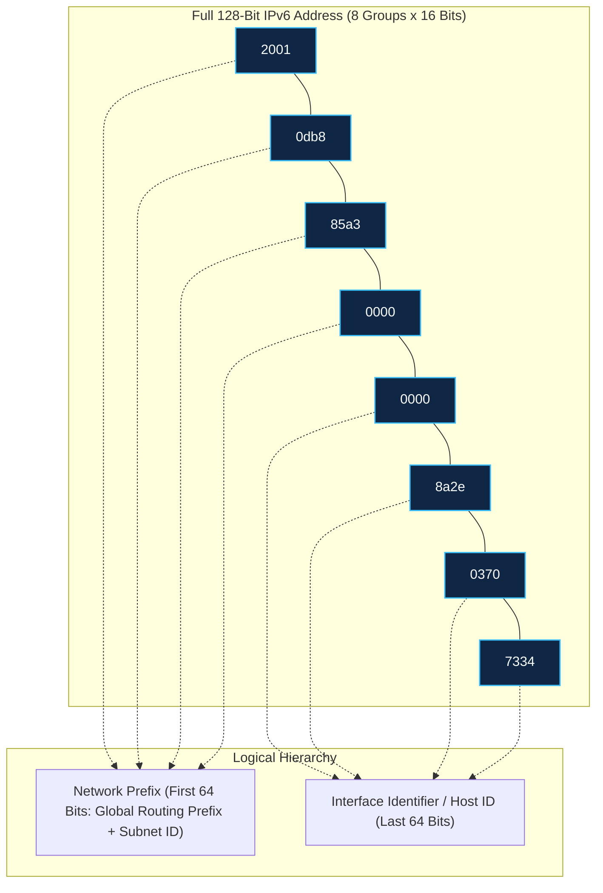

 

## What is IPv6?

Internet Protocol version 6 (IPv6) is the modern, next-generation network layer protocol designed by the Internet Engineering Task Force (IETF) to replace the legacy IPv4 standard:

* **Bit Size:** IPv6 utilizes a massive 128-bit address architecture, multiplying network scalability exponentially beyond older 32-bit standards.
* **Address Length:** The 128 bits are structured into 16 bytes (octets), organized conceptually into 8 groups of 16-bit blocks.
* **Format:** Written human-readably in hexadecimal notation, with each 16-bit group separated by colons (for example, `2001:0db8:85a3:0000:0000:8a2e:0370:7334`).
* **Astronomical Address Pool:** A 128-bit address space yields 2^128 distinct addresses, representing approximately 3.4 x 10^38 unique addresses (enough to assign billions of IP addresses to every grain of sand on Earth).
* **Why it was Created (IPv4 Exhaustion):** In the 1990s, the explosive proliferation of connected personal computers, mobile smartphones, cloud data centers, and IoT devices rapidly depleted the 4.29 billion address pool of IPv4. IPv6 was engineered to solve address exhaustion permanently while introducing native security and efficiency.
* **Integrated Protocol Enhancements:** Built-in mandatory support for IP Security (IPSec), streamlined header processing with fixed 40-byte base headers, automatic address configuration via SLAAC, and the complete elimination of network-wide broadcast overhead.

---

## IPv6 Address Structure

To interpret an IPv6 address, engineering students must understand how hexadecimal characters represent binary bits within network interfaces:

* **8 Hexadecimal Groups (Hextets):** An IPv6 address is partitioned into 8 separate blocks, commonly termed "hextets" or "quads", delimited by colons (`:`).
* **4 Hex Digits per Group:** Each group consists of 4 hexadecimal digits (e.g., `2001`, `0db8`, `8a2e`).
* **Bit Conversion:** Since each single hexadecimal character represents exactly 4 binary bits (one nibble), each 4-digit group equals 16 bits (4 digits x 4 bits = 16 bits).
* **Total Length Calculation:** Multiplying 8 groups by 16 bits yields the full 128-bit address length (8 x 16 = 128 bits).

### Logical Address Partitioning (64/64 Rule)
In standard unicast addressing, an IPv6 address is conceptually bisected into two 64-bit segments:
1. **Network Prefix (First 64 bits):** Identifies the specific global routing prefix assigned by regional Internet registries to the ISP, combined with the organization's internal Subnet ID.
2. **Interface Identifier (Last 64 bits):** Uniquely identifies the host interface on that subnet, derived from the hardware MAC address via the EUI-64 process or generated as a randomized pseudorandom token for privacy.

---

## IPv6 Address Notation Simplification

Because writing out 32 hexadecimal characters is cumbersome and error-prone, RFC 4291 and RFC 5952 define two standardized compression rules to simplify IPv6 address notation:

### Rule 1: Omitting Leading Zeros
Within any individual 16-bit group, leading zeros do not carry mathematical value and can be safely omitted.
* **The Rule:** In any 4-digit group, you can drop any zeros appearing before the first non-zero digit.
* **Examples:**
  * `0db8` becomes `db8`
  * `0042` becomes `42`
  * `0001` becomes `1`
  * `0000` becomes `0` (at least one zero must remain to represent the group)
* **Crucial Constraint:** Trailing zeros must NEVER be omitted. For instance, `85a0` cannot be shortened to `85a`, because omitting a trailing zero changes the binary value from `1000010110100000` to `0000100001011010`.

### Rule 2: Double Colon (::) Rule
Consecutive blocks composed entirely of zeros can be compressed into a single double colon (`::`).
* **The Rule:** Any single contiguous string of one or more 16-bit blocks containing all zeros (`0000:0000:...`) can be replaced by a double colon (`::`).
* **Exam Rule & Critical Constraint:** The double colon (`::`) can only be used **EXACTLY ONCE** in an entire IPv6 address. If used multiple times, the address becomes mathematically ambiguous because a router cannot determine how many zero-blocks each double colon represents.
* **Tie-Breaking Convention (RFC 5952):** If an address contains multiple non-contiguous runs of zero blocks, the double colon MUST be applied to the longest consecutive run. If the runs are equal in length, compress the first run occurring on the left.

### Complete Step-by-Step Simplification Example

Let us compress the following raw, uncompressed 128-bit IPv6 address step by step:

* **Step 0 (Original Uncompressed Address):**  
  `2001:0db8:0000:0000:0000:ff00:0042:8329`

* **Step 1 (Apply Rule 1: Omit Leading Zeros):**  
  Drop leading zeros in `0db8` -> `db8`, in `0000` -> `0`, and in `0042` -> `42`:  
  `2001:db8:0:0:0:ff00:42:8329`

* **Step 2 (Apply Rule 2: Compress Consecutive Zeros with Double Colon):**  
  Replace the three contiguous `0:0:0` blocks with a single `::`:  
  `2001:db8::ff00:42:8329`

### Notable Special Addresses in Compressed Notation
* **Unspecified Address:** `0000:0000:0000:0000:0000:0000:0000:0000` compresses entirely to `::`
* **Loopback Address (Localhost):** `0000:0000:0000:0000:0000:0000:0000:0001` compresses to `::1`
* **Default Route:** `::/0` (equivalent to `0.0.0.0/0` in IPv4)

---

## Types of IPv6 Addresses

Unlike IPv4, which relies heavily on broadcast traffic, IPv6 structures communications across three distinct architectural transmission scopes:

* **Unicast Address:** Identifies a single interface on a network node. Packets addressed to a unicast destination are routed directly to that specific interface. Primary categories include:
  * **Global Unicast Address (GUA):** Globally unique and routable across the public Internet, equivalent to public IPv4 addresses (allocated within prefix `2000::/3`).
  * **Link-Local Address:** Automatically configured on every network interface for local link communication only (starts with prefix `fe80::/10`). Routers do not forward link-local packets past the local physical segment.
  * **Unique Local Address (ULA):** Private addressing reserved for internal enterprise communications across private sites, analogous to RFC 1918 private IPv4 spaces (allocated within prefix `fc00::/7`).
* **Multicast Address:** Identifies a group of interfaces that belong to a multicast subscription group (starts with prefix `ff00::/8`). A packet sent to a multicast address is delivered to all interfaces subscribed to that specific group.
* **Anycast Address:** Assigned to multiple interfaces (typically on geographically distributed servers). Network routing protocols route anycast packets to the single topologically closest interface according to routing distance metrics.

### Key Architectural Note: No Broadcast in IPv6
IPv6 completely eliminates the broadcast address type. In IPv4, broadcast transmissions periodically disrupt every single device on a LAN segment (for example, ARP requests). In IPv6, all traditional broadcast tasks are handled using targeted Multicast groups (such as the Solicited-Node Multicast address within the Neighbor Discovery Protocol - NDP), ensuring devices only process packets intended for their services.

---

## Frequently Asked Questions (FAQ)

### Can the double colon (::) be used more than once in an IPv6 address?
No, the double colon can only be used once in an address. Using it twice causes mathematical ambiguity because network routers would be unable to calculate how many groups of zeros each double colon represents, rendering the address unroutable.

### How does IPv6 discover MAC addresses without ARP broadcasts?
IPv6 replaces the legacy Address Resolution Protocol (ARP) with the Neighbor Discovery Protocol (NDP). NDP operates using ICMPv6 messages over targeted multicast groups (Solicited-Node Multicast) instead of network-wide broadcast storms, preserving switch CPU cycles and bandwidth.

### What is the IPv6 equivalent of the IPv4 localhost address 127.0.0.1?
The IPv6 loopback address is written in fully compressed notation as `::1` (which expands mathematically to `0000:0000:0000:0000:0000:0000:0000:0001`). It routes packets internally back to the local host operating system without placing signals onto physical media.

### What is a Link-Local address and why is it important?
A Link-Local address begins with the prefix `fe80::/10` and is automatically generated by an operating system interface as soon as IPv6 is enabled. It allows immediate local communication across a local link (such as neighbor discovery, router advertisements, and DHCP configuration) even before a global public address is assigned.

---

## Conclusion & Next Topic

Mastering IPv6 address formatting, hexadecimal notation, and the mathematical rules of compression is foundational for computer science undergraduates, systems engineers, and network administrators. As enterprises and telecom providers transition worldwide to IPv6-only architectures, these fundamentals ensure you can configure, diagnose, and audit modern routing topologies with confidence.

To review the foundational logical addressing principles of IPv4, revisit our detailed guide on **[IP Addressing](ip-addressing-computer-networks.html)**.

Next Topic: Learn about the Difference Between IPv4 and IPv6.

---

## 🏢 About VYOMARC Technologies

**VYOMARC Technologies** is an engineering-first software architecture and digital technology company based in Ramchandarpur, Bihar Sharif, Nalanda, Bihar (PIN 803216). We engineer production-grade enterprise software, custom high-performance web systems, and secure institutional platforms.

* **Office Address:** Ramchandarpur, Bihar Sharif, Nalanda, Bihar - 803216
* **Email:** vyomarctechnologies@gmail.com
* **Call / WhatsApp:** +91 825 270 2699
* **Operational Hours:** Mon-Sat, 10:00 AM to 4:00 PM

