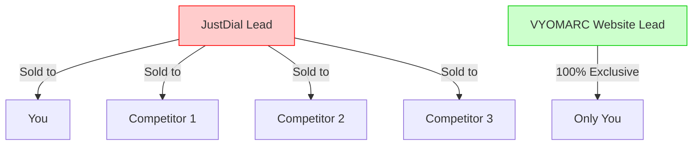

  

---

> **त्वरित सारांश (Quick Summary):** JustDial या अन्य बिजनेस डायरेक्टरी पर जब भी कोई ग्राहक कॉल या मैसेज करता है, तो वही एक लीड आपके अलावा आपके 3 से 4 कॉम्पिटिटर्स को भी एक ही सेकंड में भेज दी जाती है। आप हर महीने हजारों रुपये चुकाते हैं, लेकिन फिर भी सबसे सस्ते दाम पर सर्विस देने की अंधी दौड़ में फंस जाते हैं। अपनी खुद की वेबसाइट और Google लोकल सर्च से आने वाला हर ग्राहक 100% केवल आपका होता है।

---

आप एक क्लिनिक, जिम, निजी स्कूल या कोचिंग चलाते हैं। आपने जस्टडायल (JustDial) पर हर महीने हजारों रुपये खर्च किए। फोन बजते हैं, लेकिन कई बार ग्राहक किसी और के पास चला जाता है या फोन उठाकर कहता है कि "मुझे दूसरे डॉक्टर या कोचिंग वाले ने पहले ही कॉल कर लिया है।"

कभी आपने ठंडे दिमाग से सोचा है कि ऐसा क्यों होता है?

इसका कड़वा सच यह है कि जस्टडायल आपको कोई "एक्सक्लूसिव" ग्राहक नहीं देता। इसे बिजनेस की भाषा में **Shared Lead Model** कहते हैं। यानी जैसे ही कोई मरीज़ या छात्र जस्टडायल पर सर्च करता है, उसका नंबर एक साथ 4 अलग-अलग डॉक्टरों या कोचिंग संचालकों के फोन पर SMS और WhatsApp के जरिए चला जाता है।

अब सोचिए: जिसने सबसे पहले कॉल किया या जिसने अपनी फीस सबसे सस्ती बताई, ग्राहक उसके पास चला गया। आप पैसे भी दे रहे हैं और फिर भी अपने ही शहर में दूसरों से रेट कम करने की मजबूरी में लड़ रहे हैं।

---

## जस्टडायल का असली गणित (The Real Math)

आइए ज़रा हिसाब लगाकर देखते हैं कि आपका कितना पैसा पानी में बह रहा है:

* **मासिक पैकेज:** मान लीजिए आप जस्टडायल को हर महीने ₹3,000 की बेसिक किस्त देते हैं।
* **सालाना सीधा खर्च:** 12 महीने में यह सीधा ₹36,000 हो जाता है।
* **लीड्स की हकीकत:** आपको महीने में 40 लीड्स मिलीं। लेकिन वो 40 लीड्स आपके 3 पड़ोसियों को भी मिलीं। यानी कुल 160 बार एक ही ग्राहक को परेशान किया गया।
* **कन्वर्जन दर:** साझा की गई लीड्स में से मुश्किल से 5% से 10% ग्राहक ही आपके पास टिकते हैं।
* **समय और स्टाफ का नुकसान:** आपका रिसेप्शनिस्ट या काउंसलर दिन भर ऐसे लोगों को फोन मिलाने में लगा रहता है जो या तो फोन काट देते हैं या कहते हैं कि "काम हो गया।"

अगर आप महीने के ₹3,000 देते हैं, तो साल के ₹36,000 सिर्फ अपने ही ग्राहकों को पाने के लिए अनजान लोगों से लड़ने में चले जाते हैं। प्रीमियम पैकेज लेने वाले व्यापारी तो साल का ₹60,000 से ₹1,20,000 तक गंवा देते हैं।

---

---

## असली समस्या क्या है? (The Core Issue)

समस्या यह है कि आप अपना "डेटा" (Data) किसी और को दे रहे हैं।

जब आप जस्टडायल या किसी भी थर्ड-पार्टी डायरेक्टरी पर निर्भर होते हैं, तो ग्राहक आपका नहीं, बल्कि उस प्लेटफॉर्म का होता है। जिस दिन आप अपनी मासिक किस्त देना बंद करेंगे, उसी दिन आपकी दुकान या क्लिनिक का फोन बजना बंद हो जाएगा।

इसके उलट, जब कोई ग्राहक सीधे आपकी अपनी वेबसाइट या Google Business प्रोफाइल से आता है:
1. **100% एक्सक्लूसिव लीड:** वह ग्राहक सिर्फ और सिर्फ आपके बारे में पढ़ रहा है। उसका नंबर किसी कॉम्पिटिटर के पास नहीं जाता।
2. **विश्वास और ब्रांड वैल्यू:** ग्राहक सीधे आपके क्लिनिक, रिजल्ट्स, फोटो और फीस को देखता है। यहाँ कोई बिचौलिया नहीं होता।
3. **शून्य कमीशन:** वेबसाइट से चाहे 10 ग्राहक आएं या 1000 ग्राहक, आपको किसी को प्रति-लीड कमीशन नहीं देना होता।

---

## VYOMARC का समाधान (The Solution)

स्थानीय स्तर पर बिज़नेस बढ़ाने का सबसे टिकाऊ तरीका है: **अपने ट्रैफिक के खुद मालिक बनिए।**

किराए के मकान में रहकर आप कभी भी घर के मालिक नहीं बन सकते। उसी तरह एग्रीगेटर प्लेटफॉर्म पर लिस्टिंग करके आप अपना ब्रांड नहीं बना सकते।

VYOMARC Technologies बिहार और पूरे भारत के स्थानीय बिज़नेस के लिए कस्टम-कोडेड, सुपरफास्ट वेबसाइट्स और लोकल SEO सिस्टम तैयार करती है:

* **Google Maps और लोकल सर्च में टॉप रैंकिंग:** जब कोई आपके शहर में *"Best Coaching in Bihar Sharif"* या *"Best Dental Clinic near me"* सर्च करे, तो सबसे ऊपर आपकी अपनी वेबसाइट दिखे।
* **डायरेक्ट WhatsApp बुकिंग:** ग्राहक सीधे आपकी वेबसाइट से एक क्लिक में आपके WhatsApp पर इंक्वायरी भेजेगा।
* **आजीवन मालिकाना हक:** वेबसाइट का पूरा कोड, डोमेन और डेटा 100% आपका होता है। कोई मासिक रेंट नहीं।

---

## अपना नुकसान खुद चेक करें (Introducing the Tool)

क्या आप जानना चाहते हैं कि आप जस्टडायल या अन्य डायरेक्टरी पर हर साल वास्तव में कितना पैसा और कितने ग्राहक गंवा रहे हैं?

हमने स्थानीय व्यापारियों के लिए एक बिल्कुल फ्री टूल बनाया है: **JustDial Lead Sharing Scanner & Loss Calculator**।

इस टूल में आप बस अपना मासिक खर्च, मिलने वाली अनुमानित लीड्स और अपने एक ग्राहक की औसत वैल्यू डालेंगे। यह टूल गणितीय रूप से कैलकुलेट करके दिखाएगा कि शेयर्ड लीड्स और प्राइस-वॉर के कारण आपका साल भर का कितना नुकसान हो रहा है।

👉 **[यहाँ क्लिक करें और अपना नुकसान चेक करें](/tools/justdial-scanner/index.html)**

---

## टूल कैसे काम करता है? (How it Works)

यह टूल इस्तेमाल करना बेहद आसान है और इसके लिए किसी तकनीकी ज्ञान की आवश्यकता नहीं है:

1. **स्टेप 1: अपना मासिक खर्च डालें:** आप जस्टडायल या एग्रीगेटर को हर महीने जो भी राशि देते हैं (जैसे ₹2,500 या ₹5,000), उसे दर्ज करें।
2. **स्टेप 2: लीड्स और क्लाइंट वैल्यू डालें:** आपको औसतन कितनी लीड्स मिलती हैं और एक पक्के ग्राहक से आपको कितना मुनाफा होता है, वह चुनें।
3. **स्टेप 3: अपनी असली लॉस रिपोर्ट देखें:** टूल तुरंत आपको बताएगा कि आपकी कितनी लीड्स कॉम्पिटिटर्स के पास जा रही हैं और उसी बजट में अपनी खुद की वेबसाइट आपको कितने गुना अधिक मुनाफा दे सकती है।

---

## निष्कर्ष (Conclusion & Next Steps)

जस्टडायल को पूरी तरह छोड़ने की जरूरत नहीं है, लेकिन अपना खुद का डिजिटल घर (Website) बनाना जरूरी है।

स्मार्ट व्यापारी कभी भी अपने सारे अंडे एक ही टोकरी में नहीं रखते। जब तक आप किसी थर्ड-पार्टी पर निर्भर रहेंगे, आपका बिज़नेस हमेशा असुरक्षित रहेगा। आज ही अपने खुद के ब्रांड में निवेश कीजिए ताकि आने वाले 5 से 10 सालों तक आपका ग्राहक सिर्फ आपका ही रहे।

अपनी दुकान, क्लिनिक या कोचिंग के लिए एक आधुनिक, फास्ट और परिणाम देने वाली वेबसाइट शुरू करने के लिए हमसे संपर्क करें:

👉 **[VYOMARC से अपनी वेबसाइट बनवाएं](/website-development-services-bihar.html)**
