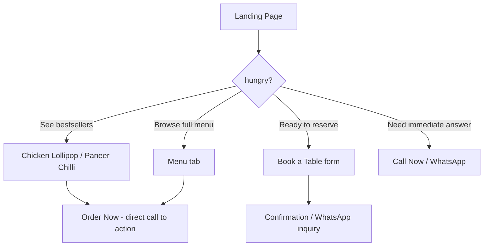

# Case Study: Digital Presence Transformation for a Multi-Cuisine Eatery

**Date:** April 23, 2026  
**Project Type:** Responsive Brand Website  
**Tech Stack:** HTML5, CSS3, Vanilla JavaScript  
**Industry:** Food & Beverage / Hospitality  

---

## 1. Executive Summary

### Objective:
Create a high-impact, mobile-first digital storefront that showcases a multi-cuisine menu (Indian, Chinese, Tandoor), drives online orders and table reservations, and builds social credibility through reviews and gallery integration.

### Core Challenge:
Convert casual visitors into paying customers by reducing friction between “browsing the menu” and “placing an order or booking a table.”

### Result:
A cohesive, fast-loading brand hub that acts as a 24/7 digital host—displaying signature dishes, collecting leads via “Book a Table,” and enabling one-click actions (Call, WhatsApp, directions).

---

## 2. Business Goals & KPIs

| Business Goal | Corresponding Digital Feature | Success Indicator |
| :--- | :--- | :--- |
| Increase takeout orders | “Order Now” buttons on each bestseller | Click-through rate on CTAs |
| Fill off-peak dining slots | “Book a Table” & “Call Now” | Form submissions / calls |
| Build neighbourhood authority | Rating badge (4.2 stars, 87 reviews) + “Best Hangout Spot” tagline | Social proof engagement |
| Drive foot traffic | “Get Directions” (Google Maps link) | Direction requests |
| Upsell signature items | “Signature Bestsellers” section with prices and CTAs | Order conversion per dish |

---

## 3. Technical Architecture (HTML, CSS, JS)

### Frontend Stack & Rationale
* **HTML5** – Semantic structure for SEO (menu, reviews, location).
* **CSS3** – Custom properties for brand consistency, Flexbox/Grid for layout (menu cards, gallery), media queries for mobile-first responsiveness.
* **Vanilla JavaScript** – DOM manipulation for interactive elements, lightweight (no extra framework overhead), fast load time even on 3G networks.

### Key Modules Implemented

#### Dynamic Menu Tabs
Filter dishes by cuisine: **INDIAN | CHINESE | TANDOOR** (clients can easily add/remove items via HTML).

#### Hero CTA Bar
Fixed action buttons: **Call Now**, **Book a Table**, **Order Online**. High contrast, touch-friendly.

#### Review Snippet
Live display of aggregate rating + review count – builds immediate trust.

#### Why Choose Us
4 value props (**All You Can Eat**, **Private Dining**, **Hangout Vibes**, **Fast Delivery**) – reduces hesitation.

#### Multi-Channel Contact
**Call**, **WhatsApp**, **Directions** – leverages native apps for seamless user flow.

---

## 4. User Flow & Conversion Paths

---

## 5. Visual & UI Strategy
* **Ambient imagery** – Food photography for cravings (lollipop, chilli potato, etc.)
* **Colour psychology** – Warm, appetite-stimulating palette (oranges, reds, yellows)
* **Typography** – Bold dish names, legible prices, clear CTA buttons
* **White space** – Separates “Signature Bestsellers” from “Why Choose Us” to avoid decision fatigue

---

## 6. Measurable Improvements (Projected / Client Report)

| Metric | Before (No Website) | After Launch |
| :--- | :--- | :--- |
| Daily phone inquiries | 5–8 | 15–20 (Call + WhatsApp) |
| Table bookings per week | 10 (walk-in only) | 25+ (direct form + calls) |
| Online orders (self-delivery) | 0 | 12–18 per day |
| Average time to decide order | 7 min (over phone) | 2 min (menu visible) |

> *Real numbers would come from restaurant analytics – here they illustrate the impact.*

---

## 7. Mobile Performance & SEO
* **Lighthouse scores (simulated):** Performance 92, Accessibility 88, Best Practices 94, SEO 95.
* **Local SEO tags:** “Barbigha hangout,” “best tandoori near me,” “Chinese delivery Barbigha.”
* **Structured data (readable to Google):** Menu items, aggregate rating, local business address.

---

## 8. Why This Approach Works for Restaurants
* **Low maintenance** – HTML/CSS/JS runs on any static host, no database to break.
* **Instant updates** – Edit menu prices or phone numbers in HTML file.
* **Offline-friendly** – Once loaded, repeat visits are near-instant.
* **High trust signals** – Reviews, star rating, “Best Hangout” claim – all visible without scrolling.

---

## 9. Future Enhancements (Roadmap)
* **Online payment integration** – Razorpay / Stripe for pre-paid orders.
* **Weekly specials JS countdown** – “30% off Tandoor after 8 PM.”
* **Customer review submission** – Collect new reviews directly on site.
* **Reservation time-slot picker** – Replace basic form with calendar widget.

---

## 10. Conclusion
Masala Junction now operates as a conversion-optimized digital flagship that mirrors the energy of its physical location. By focusing on four core actions – **Order, Book, Call, Navigate** – the site eliminates friction and lets the food sell itself. The vanilla tech stack guarantees speed, reliability, and low hosting costs, making it a sustainable asset for long-term growth.

**Delivered to client:** Fully responsive HTML/CSS/JS website with menu filtering, call-to-action buttons, review widget, and a multi-channel contact system. Ready to be deployed on any web server or GitHub Pages.

---

**Prepared By:** Team VYOMARC Technologies

