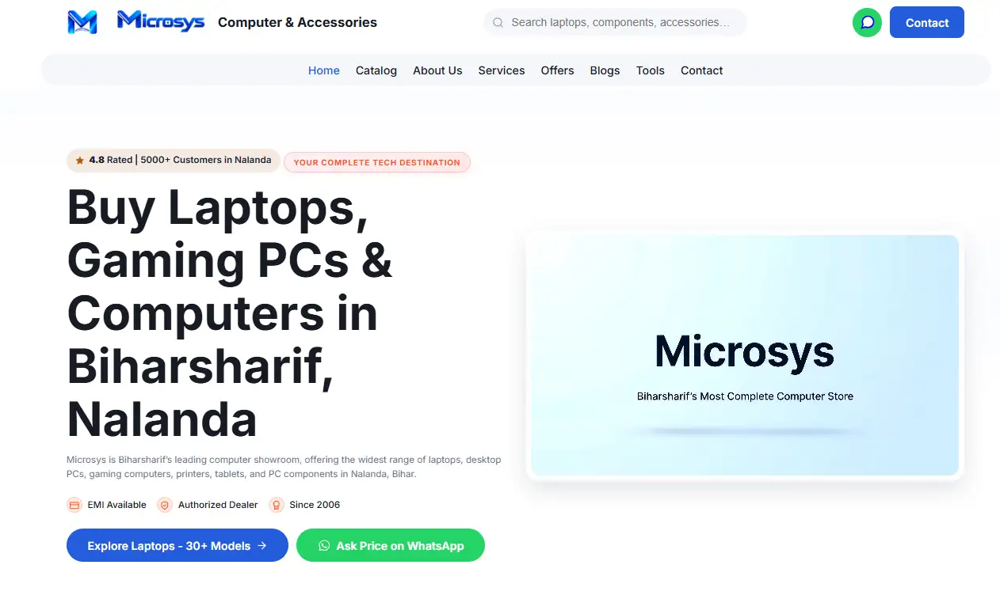
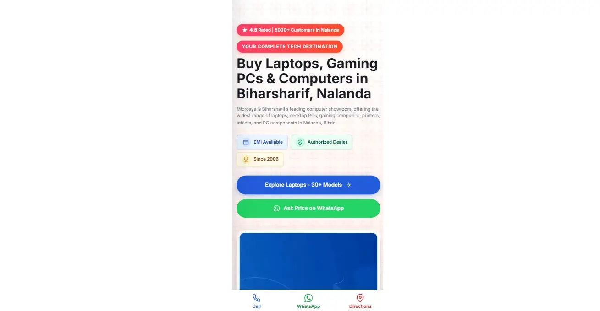
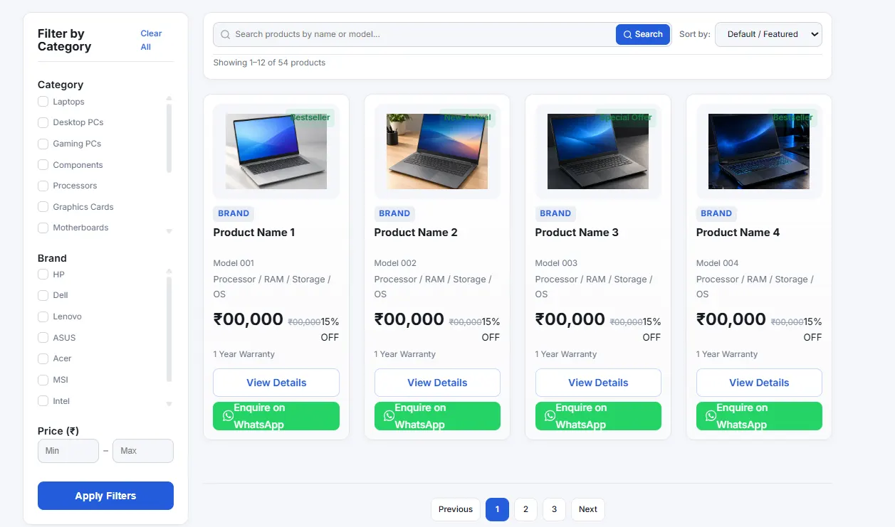
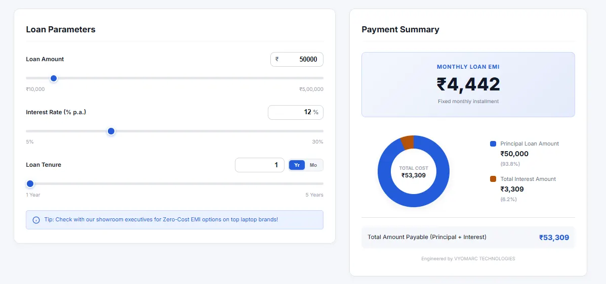
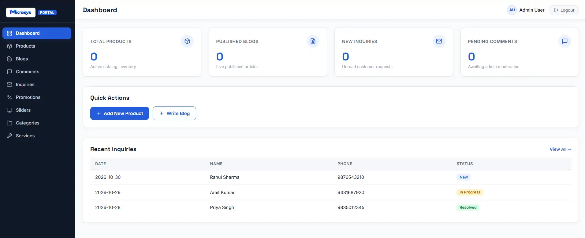

# Case Study: Architecting a Scalable Frontend & UI/UX System for Microsys

**Client:** Microsys Computer & Accessories (Jai Omkar Traders)  
**Industry:** Computer Retail & B2B Hardware Services (Tier-2 City, Bihar)  
**Agency:** VYOMARC Technologies  
**Date:** November 14, 2026  
**Project Timeline:** 4 Weeks (August – November 2026)  
**Deliverable:** High-Performance Frontend Architecture + Admin UI + 100% PHP-Ready Handover Kit  

---

## 1. Executive Summary

Finding a reliable custom web development agency in Bihar Sharif that understands both local market dynamics and global coding standards is a challenge for many B2B businesses. VYOMARC Technologies partnered with Microsys, a prominent computer retail showroom, to build a highly scalable, dynamic-ready digital storefront.

Our goal was to move beyond a standard static website and engineer a complete digital ecosystem. The project was successfully delivered on time with a 100% backend-ready codebase, complete documentation, and a zero-friction content management UI, setting a new benchmark for IT services in the region.

<em>Microsys - Premium Digital Storefront</em>

---

## 2. The Client Journey & Problem Statement

Building for a Tier-2/3 market requires a tailored approach. During our 4-week journey with the Microsys founder, we identified three critical challenges that needed a permanent fix:

* **Backend Friction (The "Raw HTML" Problem):** Often, frontend developers deliver raw HTML/CSS without data structures, leaving backend (PHP) developers guessing. Microsys needed a structured architecture ready to "plug and play."
* **Scalability for Future Tools:** The client required a dynamic system that could seamlessly integrate future modules (like EMI Calculators, B2B Margins, and CGPA tools) without breaking the core UI.
* **Local Market UI Needs:** The design had to be premium and highly converting, yet intuitive enough for local users in Bihar, keeping their specific buying habits and WhatsApp-inquiry behaviors in mind.

---

## 3. Our Solution & 3-Phase Approach

At VYOMARC Technologies, we don't just write code; we engineer digital systems. We executed a strict, professional 3-phase strategy:

### Phase 1: Database & Architecture Planning (The Foundation)

Before writing a single line of UI, we designed the complete database schema (`schema.sql`) and mapped every form field (`FORM-FIELD-MAP.md`). We locked the architecture with a 16-field product standard, ensuring zero data conflicts later.

### Phase 2: Modular Frontend Development (The Build)

We bypassed heavy frameworks and utilized lightweight, high-performance Vanilla JavaScript, pure CSS Grid/Flexbox, and HTML5. We built custom UI components (Mega Menus, Slide-out Drawers) ensuring lightning-fast load times and seamless mobile responsiveness.

<em>Mobile view with Mobile Drawer and Sticky Bottom Bar</em>

<em>Catalog Page with Filter Sidebar and Product Grid</em>

<em>EMI Calculator with Pie Chart and Interactive Sliders</em>

### Phase 3: The "Zero-Headache" Handover (The Integration)

We packaged the entire frontend into a master ZIP, accompanied by exhaustive documentation. Instead of just handing over code, we provided a `PHP-DEV-GUIDE.md`, making the backend integration a cakewalk for the client's team.

---

## 4. Technical Challenges & Scope Management

A professional agency is defined by how it handles technical roadblocks and last-minute client requests. Here is how we engineered solutions for Microsys:

### Challenge 1: Complex Responsive Layouts (CSS)

**Problem:** The Admin Panel and Catalog Page required complex data tables and filter grids that often break or overflow on mobile screens.

**Overcome:** We engineered a custom CSS approach using `overflow-x: auto` for tables and a custom responsive flex/grid logic for product cards. We ensured that the "Used vs Refurbished" infographics strictly followed a visual split on desktops but stacked cleanly without losing hierarchy on mobile devices.

### Challenge 2: High-Performance Vanilla JS Interactivity

**Problem:** Building interactive calculators (EMI, Profit) and Popup Sliders without bloating the site with heavy libraries like jQuery or React.

**Overcome:** We developed a lightweight Vanilla JS engine. We used dynamic DOM manipulation and CSS custom properties (`--pie-percentage`) to draw conic-gradient charts in real-time, ensuring 0ms lag and no page reloads.

### Challenge 3: Scope Creep & Last-Minute Compliances (The Journey)

**Problem:** Right before handover, the client requested a full Hindi-translation toggle and the urgent addition of government compliances like the GeM Seller ID and new Brand Strips.

**Overcome (The VYOMARC Standard):** We provided expert technical consulting, advising the client against a manual HTML translation to save them future backend conflicts. Meanwhile, within a 30-minute window before final deployment, our team successfully injected the GeM Seller ID badge and updated the brand grids into the master codebase without disrupting the live layout.

---

## 5. The Result & Business Impact

* **100% Seamless Integration:** Due to our strict documentation and structured fields, the client's PHP backend team can connect the database with zero guesswork.
* **On-Time Delivery:** The project was delivered exactly on schedule, complete with a professional B2B handover process (Agreement ➔ Invoice ➔ Master Source Code).
* **Long-Term Partnership:** Impressed by the code architecture and corporate transparency, Microsys has onboarded VYOMARC as their 'Referral Partner'. We are also providing a 2-month free technical support warranty on this delivery to ensure peace of mind.

<em>Custom Admin UI designed for zero-friction content management</em>

---

## 6. Client Testimonial

> "We hired VYOMARC Technologies for custom web development and frontend architecture, and the experience was outstanding. Finding a reliable B2B IT service provider can be challenging, but their team delivered top-tier UI/UX design and a highly scalable codebase exactly on schedule. What sets VYOMARC Technologies apart is their professional corporate process, clear agreements, and the exceptionally detailed backend documentation they provided for our developers. If you are looking for a premium software development agency, I highly recommend VYOMARC Technologies."  
> — **Founder, Microsys | Computer & Accessories**

---

## 7. Ready to scale your business with custom software?

अगर आप भी बिहार या पूरे भारत में अपने बिज़नेस के लिए एक रिलायबल IT और टेक पार्टनर ढूंढ रहे हैं, जो आपके प्रोजेक्ट को समय पर और बिना किसी सिरदर्दी के पूरा करे, तो आज ही हमसे बात करें।

👉 [Book a Free Consultation with VYOMARC](https://wa.me/918252702699?text=Namaste%20VYOMARC%2C%20mujhe%20website%20ke%20baare%20mein%20jaankari%20chahiye)

🌐 vyomarctech.com | Logic Without Limits.

