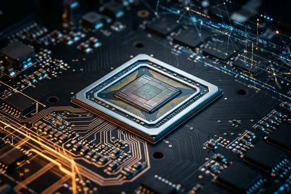

 

---

> **Quick answer:** The headline controversy surrounding Nvidia CEO Jensen Huang's confirmed extramarital affair and an independent board probe into suspected Chinese intelligence connections will not cause an immediate GPU price spike in Bihar. In China's primary Huaqiangbei electronics market, spot GPU prices are actually falling (RTX 5090 fell from ~60,000 yuan to ~50,000 yuan; RTX 5060 declined to ~3,400–3,700 yuan) due to cooling speculation and soft demand. Local computer shop owners in Patna and Bihar Sharif face near-zero immediate stock risk, but should monitor potential long-term U.S. export control tightening on high-end silicon rather than hoarding inventory out of panic.

---

## ⚡ The Controversy: What Actually Happened?

Global technology markets were jolted following reports involving Nvidia Corporation, the world's most valuable semiconductor company, and its Chief Executive Officer, Jensen Huang.

Key verifiable developments from official inquiries and investigative reporting include:
* **The Affair Confirmation:** Nvidia CEO Jensen Huang confirmed having an extramarital affair with Alice Huang, a woman suspected by U.S. intelligence agencies of operating on behalf of Chinese intelligence services.
* **The Board-Led Investigation:** Nvidia's board of directors initiated an independent investigation to determine whether Huang was targeted by a foreign espionage operation and whether proprietary semiconductor architecture or corporate governance boundaries were compromised.
* **Official State Reactions:** Beijing officially rejected the espionage allegations, dismissing the claims as "groundless" and a politically motivated "smear." Concurrently, U.S. President Donald Trump addressed the matter publicly, stating that Huang had no knowledge of the woman acting as an intelligence operative.
* **Trader Sentiment:** Electronics merchants and spot distributors in Asian hardware hubs characterize the controversy as a high-profile "personal matter" that has not disrupted factory output, foundry allocations at TSMC, or physical semiconductor packaging.

---

## 📊 Table 1: The Allegation vs. The Reality

| Strategic Dimension | U.S. Intelligence & Executive Stance | Official Beijing Response | Global Electronics Market Reality |
|:---|:---|:---|:---|
| **The Espionage Claim** | U.S. intelligence identified Alice Huang as a person of interest suspected of ties to Chinese intelligence operations. | China's Foreign Ministry rejected allegations as completely groundless and an anti-China smear campaign. | Commercial silicon distribution routes continue normal operations with zero verified factory supply disruption. |
| **Executive Knowledge** | President Trump stated Jensen Huang possessed no awareness that the individual was linked to foreign intelligence. | Emphasized that geopolitical weaponization of private matters damages cross-border technological trade. | Nvidia's board maintains an independent legal review to verify internal corporate compliance and data governance. |
| **Hardware Spot Pricing** | Speculative fears of sudden component bans or immediate trade blacklists circulated across international media. | Rejected trade restrictions, urging stable semiconductor supply chains for consumer electronics. | Spot GPU prices in Shenzhen’s Huaqiangbei electronics market dropped across high-end and mid-range tiers. |
| **Regulatory Risk** | Congressional leaders and analysts warn the U.S. may tighten export controls on advanced AI chips sold to China. | Warned that tightening unilateral tech embargoes harms multinational companies and downstream consumers. | Policy uncertainty remains concentrated on enterprise datacenter GPUs rather than mainstream desktop cards. |

---

## 📉 Hardware Market Reaction: Why Prices in Huaqiangbei Are Dropping

Contrary to rumors circulating on local social media channels suggesting an immediate global graphics card shortage, wholesale spot prices in Shenzhen’s **Huaqiangbei** market—Asia's largest physical electronics exchange—tell a completely different economic story:

* **RTX 5090 Price Correction:** The flagship enthusiast card declined from peak speculative levels of approximately **60,000 yuan** down to approximately **50,000 yuan**, reflecting waning speculative demand among secondary brokers.
* **RTX 5060 Spot Realignment:** Mainstream volume cards dropped to between **3,400 yuan and 3,700 yuan**, driven by subdued retail consumer spending and healthy supply channel replenishment.
* **Cooling Speculation:** Hardware distributors report that retail scalping has slowed significantly. With consumer demand remaining rational, institutional buyers are refusing to pay artificial markups based solely on geopolitical rumors.

---

## 🏢 What This Means for Computer Shops in Bihar Sharif & Patna

For local computer hardware retailers, system integrators, and custom PC builders operating across **Patna** (Bakarganj, SP Verma Road, Boring Road) and **Bihar Sharif** (Ramchandarpur, Ranchi Road), interpreting global supply shocks requires local market realism rather than panic.

### 1. Near-Term Retail Impact: Effectively Zero
Nvidia's commercial supply pipeline for consumer graphics cards is finalized months in advance. Consumer-grade RTX cards sold in Nalanda and Patna are imported through authorized national distribution channels (such as Ingram Micro, Redington, and Rashi Peripherals). None of these distribution agreements have faced cancellation or customs impoundment.

### 2. The Real Risk: Potential U.S. Export Control Tightening
The tangible threat does not stem from executive personal headlines, but from potential legislative fallout in Washington. Analysts caution that if the U.S. Congress responds by tightening semiconductor export controls or expanding compliance audits, high-end halo hardware (such as top-tier workstation cards and the RTX 5090 class) could see stricter documentation requirements or delayed import clearances.

In contrast, high-volume consumer cards (like the RTX 5060 and RTX 4060 series), which power gaming cafes, coaching institutes, and architectural studios across Bihar, remain well below international compute-threshold caps and are structurally insulated from trade restrictions.

---

## 📊 Table 2: Practical Impact on Bihar Computer Shops

| Hardware Segment / Operational Layer | Immediate Market Impact (0–3 Months) | Long-Term Strategic Risk (6–18 Months) | Actionable Advice for Bihar Retailers |
|:---|:---|:---|:---|
| **Mainstream Desktop GPUs (RTX 5060 / 4060)** | **Zero price inflation.** China spot prices dropping; domestic distributor stock remains stable and readily available. | Minimal risk. Mainstream compute specs sit far below national security export restrictions. | **Maintain normal rolling stock (7–14 days).** Do not pay distributor markups driven by fabricated scarcity rumors. |
| **Enthusiast Flagship GPUs (RTX 5090)** | Spot prices declining in primary wholesale hubs; domestic allocation remains limited to niche buyers. | Moderate risk. Stricter U.S. export certification could delay future regional allocations. | **Adopt back-to-back customer ordering.** Avoid locking working capital into speculative high-ticket shelf inventory. |
| **Wholesaler Credit & Inventory** | Patna wholesale distributors (Bakarganj) operating standard billing cycles without margin shocks. | Distributors may tighten credit terms if dollar exchange rates fluctuate or import tariffs adjust. | Settle distributor invoices on schedule to secure priority allocation should shipping schedules tighten later. |
| **Customer PC Build Consultations** | Local students and gamers querying shopkeepers regarding potential graphics card price hikes. | Stable component pricing encourages steady custom desktop build adoption throughout the fiscal year. | **Assure customers with verified data.** Highlight that falling China spot prices confirm component stability. |

---

## 🛠️ Actionable Playbook for Local Hardware Retailers

If you manage a computer hardware store, repair center, or custom PC assembly showroom in Bihar, adhere to these three core operating rules:

1. **Do Not Hoard High-End Stock:** Locking lakhs of rupees of working capital into RTX 5090 cards based on scandal headlines is high-risk speculation. With wholesale prices falling in Asian spot markets, hoarding exposes your shop to sharp inventory write-downs.
2. **Double Down on High-Velocity Mid-Range SKUs:** The lifeblood of regional Bihar computing is the affordable budget and mid-tier segment—gaming setups, video editing workstations, and digital service centers relying on RTX 5060 / 4060 cards. These components remain abundantly supplied and price-stable.
3. **Counter Misinformation with Sourced Facts:** Educate your retail walk-ins and commercial clients. When clients express worry about price surges, share transparent market metrics showing that spot prices in primary Asian electronics centers have corrected downward, not upward.

---

## ❓ Frequently Asked Questions (FAQ)

### Will graphics card prices increase in Patna and Bihar Sharif because of this controversy?
No. Sourced data from Asia's largest electronics hub (Huaqiangbei) demonstrates that graphics card prices have dropped (RTX 5090 fell by ~10,000 yuan; RTX 5060 sits at ~3,400–3,700 yuan). There is no empirical data pointing to an immediate retail price surge in Bihar.

### Was Nvidia's technology stolen or compromised in the scandal?
Nvidia's board of directors is conducting an independent inquiry to verify corporate compliance. Official statements from U.S. authorities confirm that Jensen Huang had no knowledge of intelligence connections, and Chinese officials have dismissed the espionage claims as groundless.

### What should local computer shops tell custom PC customers?
Inform customers that retail hardware supplies are unaffected. Recommend that customers proceed with their planned PC builds using standard mid-range components rather than delaying purchases out of fear of artificial shortages.

### Could U.S. export regulations affect graphics cards in India?
India is an authorized technology partner and not subject to Chinese entity-list restrictions. However, global regulatory scrutiny on enterprise AI GPUs could occasionally cause minor logistical delays in global shipping lanes for top-tier halo cards like the RTX 5090.

---

## 📍 Areas We Serve Across Bihar

VYOMARC Technologies provides technical infrastructure, custom software engineering, and digital solutions across:
* **Nalanda & Bihar Sharif:** Ramchandarpur, Sohsarai, Khandak Par, Ranchi Road, Rajgir.
* **Patna Metropolitan Hub:** Bakarganj, SP Verma Road, Boring Road, Bailey Road, Kankarbagh.
* **Key Commercial Centers:** Gaya, Muzaffarpur, Bhagalpur, Darbhanga, and Samastipur.

---

## 🏢 About VYOMARC Technologies

**VYOMARC Technologies** is an engineering-first software and digital technology company based in Ramchandarpur, Bihar Sharif, Nalanda, Bihar (PIN 803216). We engineer high-performance web platforms, CBT examination portals, and retail inventory management solutions for commercial enterprises and tech hardware retailers across Bihar.

* **Office Address:** Ramchandarpur, Bihar Sharif, Nalanda, Bihar — 803216
* **Email:** vyomarctechnologies@gmail.com
* **Call / WhatsApp:** +91 825 270 2699
* **Operational Hours:** Monday to Saturday, 10:00 AM – 4:00 AM

---

## 🚀 Stay Ahead with Data-Backed Technology Insights

Do not let international media sensationalism dictate your local business decisions. Connect with VYOMARC Technologies for grounded technology consulting, custom software, and digital automation.

👉 **Contact our technical consulting team today for strategic digital advisory.**

[**Chat with our Technical Team on WhatsApp (+91 825 270 2699)**](https://wa.me/918252702699?text=Hello%20VYOMARC%2C%20I%20read%20your%20hardware%20market%20analysis%20and%20would%20like%20to%20connect.)

