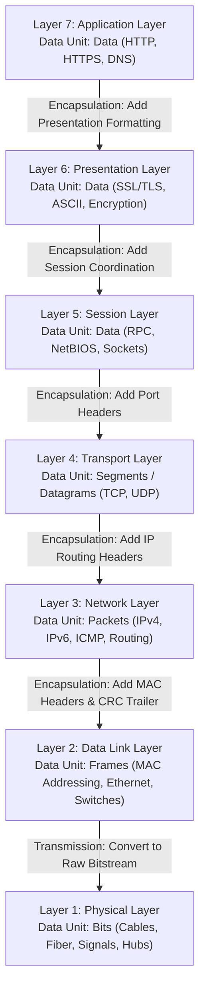

 

---

> **Quick Summary for Exam Revision:** The **OSI (Open Systems Interconnection) Reference Model** is a 7-layer theoretical framework established by the International Organization for Standardization (ISO) in 1984. It breaks down complex network communication into modular layers, establishing standardized protocols for data transmission between disparate computer systems.

---

## 1. Introduction to the OSI Reference Model

In modern computer networking, interoperability between different hardware manufacturers, operating systems, and network topologies is paramount. Before the standardization of communication protocols, proprietary systems could not easily exchange data.

To address this challenge, the **International Organization for Standardization (ISO)** developed the **OSI (Open Systems Interconnection) reference model** in 1984. 

The OSI model is an abstract 7-layer architecture that partitions the end-to-end communication process into distinct, manageable stages. Each layer performs a well-defined set of networking tasks, providing services to the layer immediately above it while receiving services from the layer below it.

### Core Principles of OSI Layering
* **Abstraction & Modularity:** Each layer operates independently; changes to protocols in one layer do not require changes in other layers.
* **Standardized Interfaces:** Clean protocol boundaries enable multivendor hardware and software interoperability.
* **Hierarchical Progression:** User data moves downward from application abstractions down to physical bits at transmission, and reverses at reception.

---

## 2. The 7 Layers of the OSI Model (Physical to Application)

The OSI model organizes networking operations into seven hierarchical layers. Layers 1–4 are commonly referred to as **Lower Layers (Media/Hardware Layers)**, while Layers 5–7 are known as **Upper Layers (Host/Software Layers)**.

```
Layer 7: Application Layer  ──┐
Layer 6: Presentation Layer   ├── Host / Software Layers (End-to-End Processing)
Layer 5: Session Layer        │
Layer 4: Transport Layer    ──┘
Layer 3: Network Layer      ──┐
Layer 2: Data Link Layer      ├── Media / Hardware Layers (Transmission & Routing)
Layer 1: Physical Layer     ──┘
```

---

### Layer 1: Physical Layer
* **Primary Function:** Transmits raw, unstructured bit streams over physical transmission media (copper cables, optical fiber, or wireless RF channels) and manages electrical, mechanical, and timing specifications.
* **Key Responsibilities:** Bit synchronization, physical topologies (star, bus, mesh), transmission modes (simplex, half-duplex, full-duplex), signal modulation, and pin configurations.
* **Protocol Data Unit (PDU):** **Bits**
* **Standard Hardware & Protocols:** Hubs, Repeaters, Network Interface Cards (NIC physical layer), Cat6 Ethernet, RS-232, Fiber Optics, RJ45.

---

### Layer 2: Data Link Layer (DLL)
* **Primary Function:** Provides reliable node-to-node data transfer across a single physical link by packaging bits into frames, managing physical (MAC) addressing, detecting transmission errors, and controlling data flow.
* **Sublayers:**
  1. **Logical Link Control (LLC):** Manages link multiplexing, flow control, and error notification.
  2. **Media Access Control (MAC):** Controls hardware access to the physical transmission medium using physical MAC addresses (e.g., CSMA/CD, CSMA/CA).
* **Protocol Data Unit (PDU):** **Frames**
* **Standard Hardware & Protocols:** Layer 2 Switches, Bridges, Ethernet (IEEE 802.3), Wi-Fi (IEEE 802.11), ARP, PPP, VLAN (802.1Q).

---

### Layer 3: Network Layer
* **Primary Function:** Handles logical host-to-host addressing across disparate physical networks and determines optimal multi-hop routing paths for data packets from source to destination.
* **Key Responsibilities:** Logical addressing (IPv4/IPv6), path determination, packet routing, internetworking, and packet fragmentation/reassembly.
* **Protocol Data Unit (PDU):** **Packets**
* **Standard Hardware & Protocols:** Routers, Layer 3 Switches, IPv4, IPv6, ICMP, IGMP, OSPF, BGP, RIP.

---

### Layer 4: Transport Layer
* **Primary Function:** Delivers reliable or best-effort end-to-end process-to-process communication, managing segmentation, port-based multiplexing, flow control, and error recovery.
* **Key Responsibilities:** Service-point (port) addressing, segment reassembly using sequence numbers, connection establishment (3-way handshake in TCP), and window-based flow control.
* **Protocol Data Unit (PDU):** **Segments** (TCP) / **Datagrams** (UDP)
* **Standard Protocols:** TCP (Transmission Control Protocol), UDP (User Datagram Protocol), SCTP.

---

### Layer 5: Session Layer
* **Primary Function:** Establishes, coordinates, synchronizes, and terminates communication sessions (dialogs) between two software applications running on different network endpoints.
* **Key Responsibilities:** Session checkpointing and synchronization (inserting recovery checkpoints into data streams), dialog control (full-duplex vs. half-duplex coordination), and session reconnection.
* **Protocol Data Unit (PDU):** **Data**
* **Standard Protocols:** NetBIOS, RPC (Remote Procedure Call), PPTP, SOCKS5.

---

### Layer 6: Presentation Layer
* **Primary Function:** Standardizes data formats between communicating systems by handling syntax and semantics, ensuring that user data formatted on one operating system is intelligible to another.
* **Key Responsibilities:** Data translation (e.g., ASCII to EBCDIC), data compression for bandwidth efficiency, and end-to-end encryption/decryption (cryptographic security).
* **Protocol Data Unit (PDU):** **Data**
* **Standard Formats & Protocols:** SSL/TLS, MIME, ASCII, UTF-8, JSON, XML, JPEG, MPEG.

---

### Layer 7: Application Layer
* **Primary Function:** Directly interfaces with user-facing software applications, providing standard application services such as web browsing, file transfers, remote administration, and electronic mail.
* **Key Responsibilities:** Network virtual terminals, resource sharing, directory lookups, and identifying communication partners.
* **Protocol Data Unit (PDU):** **Data**
* **Standard Protocols:** HTTP, HTTPS, DNS, SMTP, FTP, SSH, Telnet, DHCP, SNMP.

---

## 3. Data Flow in the OSI Model: Encapsulation & Decapsulation

When data travels across a network between two host machines, it moves through the OSI stack in two reciprocal directions: **Encapsulation** at the transmitter and **Decapsulation** at the receiver.

```
+───────────────────────────+                  +───────────────────────────+
|   SENDER (Host A)         |                  |   RECEIVER (Host B)       |
+───────────────────────────+                  +───────────────────────────+
| Application   (Data)      | ── Encapsulation | Application   (Data)      |
| Presentation  (Data)      |    (Headers add) | Presentation  (Data)      |
| Session       (Data)      |         │        | Session       (Data)      |
| Transport     (Segments)  |         │        | Transport     (Segments)  |
| Network       (Packets)   |         ▼        | Network       (Packets)   |
| Data Link     (Frames)    |    Transmission  | Data Link     (Frames)    |
| Physical      (Bits)      | ═══════════════> | Physical      (Bits)      |
+───────────────────────────+                  +───────────────────────────+
                                               ▲
                                               └── Decapsulation (Headers strip)
```

### Sender Side: Data Encapsulation (Top to Bottom)
1. **Application/Presentation/Session (L7–L5):** The user application initiates data. Presentation converts and encrypts it; Session establishes the dialog, creating the raw **Data Payload**.
2. **Transport Layer (L4):** Appends a **Transport Header ($H_4$)** containing source and destination port numbers plus sequence and acknowledgement numbers, creating a **Segment**.
3. **Network Layer (L3):** Appends a **Network Header ($H_3$)** containing source and destination IP addresses, creating a **Packet**.
4. **Data Link Layer (L2):** Appends a **Data Link Header ($H_2$)** containing physical source and destination MAC addresses, and appends a **Frame Check Sequence Trailer ($T_2$)** containing CRC error-detection codes, creating a **Frame**.
5. **Physical Layer (L1):** Converts the binary frame into electrical voltages, light pulses, or radio frequencies and transmits the raw **Bits** across the transmission medium.

### Receiver Side: Data Decapsulation (Bottom to Top)
1. **Physical Layer (L1):** Receives physical signals from the cable or antenna, reconstructs the raw binary bitstream, and forwards it to Layer 2.
2. **Data Link Layer (L2):** Checks the Frame Check Sequence (FCS) to verify data integrity. If error-free and matching the host MAC address, it strips $H_2$ and $T_2$ and passes the packet to Layer 3.
3. **Network Layer (L3):** Inspects the destination IP address. If verified, it strips the $H_3$ header and forwards the segment to Layer 4.
4. **Transport Layer (L4):** Verifies the segment checksum, reorders out-of-order packets using sequence numbers, strips the $H_4$ header, and directs the payload to the target process via its port number.
5. **Session/Presentation/Application (L5–L7):** Manages session state, decrypts and decompresses data, and passes the clean application payload to the target software (e.g., web browser).

---

## 4. Comprehensive OSI Reference Table

| Layer # | Layer Name | PDU (Data Unit) | Primary Function | Addressing Type | Key Protocols & Devices |
| :--- | :--- | :--- | :--- | :--- | :--- |
| **7** | **Application** | Data | User interaction & network services | Service / URL | HTTP, HTTPS, DNS, SMTP, FTP |
| **6** | **Presentation**| Data | Data translation, encryption, compression | Syntax / Encoding | SSL/TLS, ASCII, JPEG, JSON |
| **5** | **Session** | Data | Connection establishment & synchronization | Session ID | NetBIOS, RPC, SOCKS5, PPTP |
| **4** | **Transport** | Segment / Datagram | Process-to-process delivery & flow control | Port Numbers (16-bit) | TCP, UDP, SCTP |
| **3** | **Network** | Packet | Host-to-host routing & logical addressing | IP Address (32/128-bit)| IPv4, IPv6, ICMP, Routers |
| **2** | **Data Link** | Frame | Node-to-node hop delivery & error check | MAC Address (48-bit) | Ethernet, Switches, Bridges, ARP |
| **1** | **Physical** | Bits | Raw physical transmission over medium | Physical Signal | Hubs, Repeaters, Cat6, Fiber |

---

## 5. Advantages & Disadvantages of the OSI Model

Understanding both the strengths and structural limitations of the OSI architecture is a frequent subject in B.Tech university examinations and technical interviews.

### Advantages of the OSI Model
1. **Standardized Architecture:** Establishes vendor-independent standards allowing diverse hardware (Cisco, Juniper, Linux, Windows) to interconnect without proprietary translation layers.
2. **Easy Troubleshooting:** Enables systematic diagnostic isolation. Network engineers can troubleshoot issues layer by layer (e.g., verifying physical link status at Layer 1 before testing IP reachability at Layer 3).
3. **Modularity & Layer Independence:** Protocols at one layer can be swapped or upgraded (e.g., migrating from IPv4 to IPv6 at Layer 3) without requiring alterations to the underlying physical medium or upper application software.
4. **Pedagogical Clarity:** Serves as the universal theoretical baseline for studying network engineering, layered abstraction, and protocol hierarchies.

### Disadvantages of the OSI Model
1. **Theoretical vs. Practical Dominance (TCP/IP):** The OSI model was developed during the 1980s when the simpler, pragmatic **TCP/IP model** was already actively deployed on the ARPANET and early internet. As a result, OSI remained largely a reference model rather than a commercial deployment.
2. **High Protocol Overhead:** The rigid separation of seven distinct layers introduces processing overhead, redundant header encapsulations, and latency compared to streamlined 4-layer architectures.
3. **Duplication of Services:** Certain operations are redundantly duplicated across layers. For example, error detection and flow control are performed at both the Data Link Layer (Layer 2) and the Transport Layer (Layer 4).
4. **Underutilized Upper Layers:** In modern applications, the functions of the Session (Layer 5) and Presentation (Layer 6) layers are almost universally absorbed directly into Application layer libraries rather than operating as independent system services.

---

## 6. Architecture Flowchart (Mermaid Diagram)

The following vertical flowchart visualizes the 7 layers of the OSI model from top (Application) to bottom (Physical), illustrating both the encapsulation flow and corresponding Protocol Data Units (PDUs):



