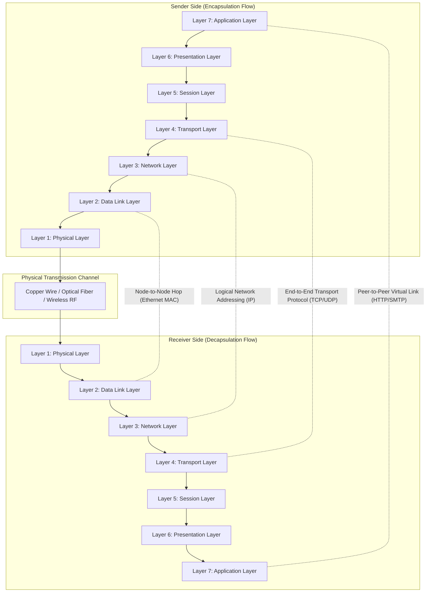
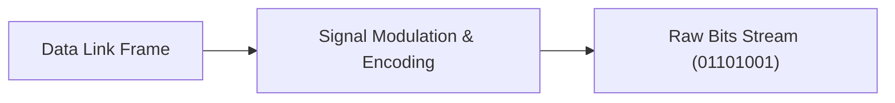
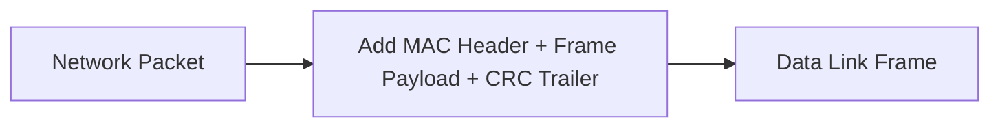
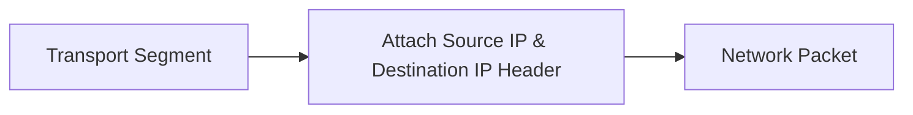
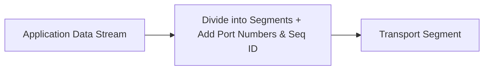
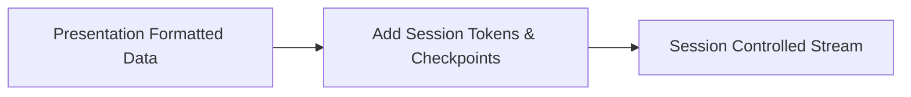
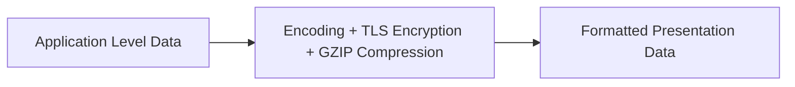

 

## Definition of OSI Reference Model

The OSI (Open Systems Interconnection) Reference Model is a conceptual architectural framework that standardizes the communication functions of telecommunication and computing systems regardless of their underlying hardware or software technology. When a computing device transmits data across a network, the payload does not travel as an arbitrary, unstructured stream. Instead, it traverses distinct, well-defined functional layers that structure, encapsulate, address, and convert raw user data into physical signals, which are subsequently received, decoded, and presented at the destination endpoint.

* **Full Form:** Open Systems Interconnection Reference Model.
* **1 Line History:** Developed by the International Organization for Standardization (ISO) in 1984 to establish universal networking standards.
* **Purpose:** To standardize network communication protocols and hardware interactions, enabling disparate systems to communicate reliably without proprietary constraints.
* **7 Layers:** The architecture comprises seven hierarchical layers: Physical, Data Link, Network, Transport, Session, Presentation, and Application Layer.
* **Why it matters:** It provides vendor independence and interoperability. Equipment from different manufacturers (such as Cisco routers and HP switches) can interoperate seamlessly because all network components adhere to unified OSI standards.

---

## Layers of OSI Model (Sender & Receiver Architecture)

Network communication operates on a bidirectional sender-receiver architecture. Data transmission originates at the sending node and concludes at the receiving host.

When the sender transmits data, execution flows from **Top to Bottom**: originating at Layer 7 (Application Layer) down to Layer 1 (Physical Layer). Each subsequent layer prepends its own protocol-specific header (and trailers where applicable), a process termed encapsulation.

Upon reaching the destination, the process inverts and flows from **Bottom to Top**: progressing from Layer 1 (Physical Layer) up to Layer 7 (Application Layer). Each layer validates, processes, and strips its corresponding header, a procedure known as decapsulation.

### Peer-to-Peer Communication
A fundamental principle of the OSI reference model is peer-to-peer logical communication. Each layer on the transmitting host operates as if it communicates directly with its corresponding peer layer on the receiving host. For instance, the Transport Layer on the source machine establishes end-to-end synchronization with the Transport Layer on the destination machine via protocols such as TCP, independent of the intermediate routers and switches operating across lower physical and data link layers.

---

## Detailed Breakdown of Each Layer

For university semester examinations and technical interviews, an in-depth understanding of all seven layers is essential. Below is the systematic engineering breakdown of each layer:

### 1. Physical Layer (Layer 1)
* **Definition:**
  * The lowest layer in the OSI hierarchy, directly interfacing with the physical transmission medium.
  * Responsible for transmitting raw, unstructured bit streams (0s and 1s) across physical conduits via electrical, optical, or radio frequency signals.
  * Specifies mechanical, electrical, and procedural characteristics such as cable specifications, pin layouts, voltage levels, and signal modulation.
* **Functionalities:**
  * **Bit Synchronization:** Synchronizes sender and receiver clock timings to maintain bit-level integrity.
  * **Transmission Rate:** Establishes the transmission speed, defined as the number of bits transmitted per second.
  * **Physical Topologies:** Defines the spatial arrangement of devices (Mesh, Star, Bus, or Ring topology).
  * **Transmission Mode:** Coordinates data flow direction across Simplex (unidirectional), Half-Duplex (bidirectional alternating), or Full-Duplex (simultaneous bidirectional) channels.
* **Protocols & Hardware:** Ethernet physical layer standards (10BASE-T, 100BASE-TX), RS-232, RJ-45 connectors, DSL, Optical Fiber, Repeaters, Network Hubs.
* **Connection to Previous Layer:** Receives structured data frames from the Data Link Layer (Layer 2) and encodes them into physical pulses or electromagnetic waveforms for channel transmission.
* **Simplest Example:** Physical Ethernet cables, optical fiber links, and wireless transceivers transmitting physical impulses.

---

### 2. Data Link Layer (Layer 2)
* **Definition:**
  * Responsible for establishing reliable, error-free node-to-node communication across a single physical link.
  * Partitions incoming packets from the Network Layer into structured data units known as **Frames**.
  * Divided into two distinct sublayers: Logical Link Control (LLC) for flow control and multiplexing, and Media Access Control (MAC) for hardware-level device addressing.
* **Functionalities:**
  * **Framing:** Groups the bit stream into discrete, identifiable frame units with synchronization markers.
  * **Physical Addressing:** Embeds unique 48-bit hardware MAC addresses into the frame header to distinguish source and destination network interfaces.
  * **Flow Control:** Implements buffering mechanisms to prevent a high-speed transmitter from overwhelming a slower receiver.
  * **Error Control:** Appends Cyclical Redundancy Check (CRC) codes within the frame trailer (FCS) to detect transmission errors and request retransmissions.
  * **Media Access Control:** Manages shared transmission media access to prevent collision using protocols like CSMA/CD and CSMA/CA.
* **Protocols & Hardware:** Ethernet (IEEE 802.3), Wi-Fi (IEEE 802.11), Point-to-Point Protocol (PPP), Frame Relay, Network Switches, Bridges, Network Interface Cards (NICs).
* **Connection to Previous Layer:** Assembles raw bit streams from the Physical Layer into verified frames, evaluates integrity, and forwards validated payloads to the Network Layer.
* **Simplest Example:** A local area network (LAN) switch directing Ethernet frames to exact host ports using physical MAC addresses.

---

### 3. Network Layer (Layer 3)
* **Definition:**
  * Responsible for host-to-host packet routing across disparate and interconnected networks (internetworking).
  * Determines the optimal physical and logical trajectory for data transmission from source to destination.
  * The fundamental protocol data unit at this tier is termed a **Packet** or **Datagram**.
* **Functionalities:**
  * **Logical Addressing:** Assigns globally unique logical identifiers (IPv4 or IPv6 addresses) to distinguish hosts across global network boundaries.
  * **Routing:** Evaluates shortest and least congested pathways across multi-hop networks using algorithms such as Dijkstra, Bellman-Ford, OSPF, and BGP.
  * **Packetizing:** Wraps upper-layer segments with essential source and destination network addressing metadata.
  * **Fragmentation & Reassembly:** Splits packets into smaller fragments when traversing transmission segments with smaller Maximum Transmission Unit (MTU) limits.
* **Protocols & Hardware:** Internet Protocol (IPv4, IPv6), ICMP, IGMP, ARP, RARP, Routers, Layer 3 Multi-Layer Switches.
* **Connection to Previous Layer:** Accepts segments from the Transport Layer, attaches logical routing headers to generate packets, and submits them to the Data Link Layer for local frame transit.
* **Simplest Example:** The postal sorting system utilizing postal ZIP codes to dispatch correspondence across regional and international distribution hubs.

---

### 4. Transport Layer (Layer 4)
* **Definition:**
  * Recognized as the central core ("Heart of OSI") bridging user software services with underlying hardware networks.
  * Assures end-to-end, process-to-process delivery of messages between originating and terminating application instances.
  * Guarantees reliable data transmission independent of the underlying network topologies and transit pathways.
* **Functionalities:**
  * **Service-Point (Port) Addressing:** Assigns 16-bit port numbers (such as Port 80 for HTTP, Port 443 for HTTPS, and Port 22 for SSH) to ensure segments reach the exact target process.
  * **Segmentation & Reassembly:** Decomposes large data streams into sequenced units and reconstructs them at the destination node in proper sequence.
  * **Connection Control:** Facilitates both connection-oriented communication with three-way handshakes (TCP) and low-latency connectionless datagram transmission (UDP).
  * **Flow & Error Control:** Implements sliding window flow management and end-to-end checksum verification to assure complete data reconstruction without loss.
* **Protocols:** Transmission Control Protocol (TCP), User Datagram Protocol (UDP), Stream Control Transmission Protocol (SCTP).
* **Connection to Previous Layer:** Receives message streams from the Session Layer, parses them into segments, and forwards them to the Network Layer for global routing.
* **Simplest Example:** A registered courier delivery verifying the specific recipient room number within an office tower and obtaining an acknowledgment signature upon arrival.

---

### 5. Session Layer (Layer 5)
* **Definition:**
  * Establishes, maintains, synchronizes, and terminates active dialog sessions between distributed communicating applications.
  * Coordinates interaction states and security context parameters between software processes.
  * The protocol data unit at this tier is categorized as **Data**.
* **Functionalities:**
  * **Dialog Control:** Dictates conversation directionality, establishing whether data exchanges occur in half-duplex or full-duplex mode.
  * **Synchronization & Checkpointing:** Injects synchronization checkpoints into long data streams; in the event of channel failure, transfers resume from the most recent verified checkpoint rather than restarting from zero.
  * **Token Management:** Manages operation tokens to prevent simultaneous critical transactions and mitigate race conditions across shared instances.
* **Protocols:** Network Basic Input/Output System (NetBIOS), Remote Procedure Call (RPC), Point-to-Point Tunneling Protocol (PPTP), Session Control Protocol (SCP).
* **Connection to Previous Layer:** Receives formatted payloads from the Presentation Layer, organizes them within session dialog boundaries, and submits the stream to the Transport Layer.
* **Simplest Example:** A conference telephone call involving initial identity verification, structured speaking turns, and formal session disconnection.

---

### 6. Presentation Layer (Layer 6)
* **Definition:**
  * Frequently designated as the "Syntax Layer" or "Translation Layer" of the network hierarchy.
  * Ensures that data sent from the application layer of one system is readable and interpretable by the application layer of another system.
  * Manages syntax differences, character encoding schemas, and data representations between heterogenous compute architectures.
* **Functionalities:**
  * **Data Translation:** Translates between divergent character encoding systems, such as ASCII, EBCDIC, and UTF-8.
  * **Encryption & Decryption:** Provides cryptographic data security by converting plaintext payloads into ciphertext at transmission, and reversing the transformation at reception (SSL/TLS).
  * **Data Compression:** Minimizes the bit volume of transmitted data to maximize channel throughput and reduce bandwidth overhead (JPEG, MPEG, GZIP).
* **Protocols & Formats:** Transport Layer Security (TLS/SSL), ASCII, EBCDIC, MIME, JPEG, PNG, MPEG, GIF.
* **Connection to Previous Layer:** Accepts user payloads directly from the Application Layer, performs necessary encoding, encryption, or compression, and conveys the sanitized data to the Session Layer.
* **Simplest Example:** An official diplomatic interpreter translating speech in real time between delegates speaking English and Japanese.

---

### 7. Application Layer (Layer 7)
* **Definition:**
  * The uppermost tier of the OSI reference model, directly interfacing with user software applications.
  * Serves as the window through which software applications access network resources and communication services.
  * The protocol data unit at this layer is defined as **Application Data** or **User Payload**.
* **Functionalities:**
  * **Network Virtual Terminal:** Facilitates remote host logins and command execution across distributed networks (Telnet, SSH).
  * **File Transfer, Access & Management (FTAM):** Enables distributed file movement, reading, and remote storage management (FTP, SFTP).
  * **Mail Services:** Provides application infrastructure for email transmission, routing, and message retrieval (SMTP, IMAP, POP3).
  * **Directory Services:** Provides distributed database capabilities for network resource lookup and domain resolution (DNS).
* **Protocols:** Hypertext Transfer Protocol (HTTP/HTTPS), File Transfer Protocol (FTP), Domain Name System (DNS), Simple Mail Transfer Protocol (SMTP), Dynamic Host Configuration Protocol (DHCP), Secure Shell (SSH), SNMP.
* **Connection to Previous Layer:** Captures application requests from end-user programs and transmits the formatted request data downward to the Presentation Layer for syntax processing.
* **Simplest Example:** Web browsers such as Google Chrome and Mozilla Firefox requesting web resources via HTTP/HTTPS upon a user entering a URL.

---

## Data Encapsulation & Decapsulation

A thorough understanding of network protocol execution requires tracing the systematic processes of encapsulation and decapsulation across the protocol stack.

1. **Encapsulation (Sender Side):** When a user initiates a network transmission, the Application Layer generates data. As this payload descends through the architecture, each successive layer appends control parameters within a designated header (and trailer at Layer 2). The data unit is categorized at each stage as a specific **Protocol Data Unit (PDU)**.
2. **Decapsulation (Receiver Side):** Upon arriving at the target host, the Physical Layer converts incoming signals into raw bits. The Data Link Layer inspects MAC addressing and validates the frame check sequence before stripping the frame encapsulation. The Network Layer evaluates destination IP routing metadata, the Transport Layer reassembles segments using port addresses, and the upper layers decrypt, decompress, and present the original unadulterated payload to the target application.

### OSI Model Data Units & Protocol Matrix

| Layer Number | Layer Name | Protocol Data Unit (PDU) | Primary Addressing | Standard Protocols | Key Hardware Devices |
| :--- | :--- | :--- | :--- | :--- | :--- |
| **Layer 7** | Application | Data / Message | User Interface / URLs | HTTP, HTTPS, DNS, SMTP, FTP | Gateway, Firewall |
| **Layer 6** | Presentation | Formatted Data | Character Encodings | SSL, TLS, JPEG, ASCII, MPEG | Application Gateway |
| **Layer 5** | Session | Session Data | Session ID / Tokens | RPC, NetBIOS, PPTP, SCP | Server Software |
| **Layer 4** | Transport | Segment / Datagram | Port Numbers (16-bit) | TCP, UDP, SCTP | Layer 4 Firewall, Load Balancer |
| **Layer 3** | Network | Packet | IP Address (IPv4 / IPv6) | IP, ICMP, OSPF, BGP, ARP | Router, Layer 3 Switch |
| **Layer 2** | Data Link | Frame | MAC Address (48-bit) | Ethernet, PPP, 802.11 Wi-Fi | Bridge, Network Switch, NIC |
| **Layer 1** | Physical | Bits | Signal / Frequency | RS-232, 100BASE-T, DSL | Hub, Repeater, Cables, Transceiver |

---

## Advantages & Disadvantages of OSI Model

### Advantages:
* **Modular Engineering:** Each layer functions independently. Replacing copper wiring with optical fiber at the Physical Layer requires zero modifications to upper-tier software applications.
* **Vendor Interoperability:** Standardized protocol interfaces permit networking hardware and software from competing manufacturers to communicate seamlessly.
* **Streamlined Troubleshooting:** Isolating faults becomes deterministic. If network echo requests (ping) fail, engineers identify a Layer 3 routing fault; if physical link carrier lights are extinguished, the issue is isolated to Layer 1.
* **Educational Benchmark:** The 7-layer model provides the globally accepted architectural standard for conceptualizing and teaching network engineering principles.

### Disadvantages:
* **Protocol Overhead:** The addition of headers and trailers at multiple consecutive tiers consumes bandwidth that could otherwise carry payload data.
* **Theoretical Complexity:** Real-world network deployments (such as the global Internet) implement the streamlined 4-layer TCP/IP suite rather than the full theoretical OSI protocol implementation.
* **Redundant Functional Overhead:** Error detection and flow regulation mechanisms are duplicated across both the Data Link Layer and the Transport Layer.
* **Layer Interdependence:** Complete operational independence is impossible in practice; routing, fragmentation, and address resolution necessitate coordinated multi-layer parameter exchange.

---

## Frequently Asked Questions (FAQ)

### What is the primary difference between OSI and TCP/IP model?
The OSI reference model is a 7-layer theoretical architectural framework developed in 1984 by the ISO to formalize network standards. In contrast, the TCP/IP model is a 4-layer practical framework designed around actual protocols implemented across the global Internet. While OSI treats Session and Presentation as independent layers, TCP/IP integrates these functionalities directly within the Application Layer.

### Which layer of the OSI model uses IP addresses?
The Network Layer (Layer 3) utilizes logical addressing schemas (IPv4 and IPv6) to route data across interconnected networks. Network routers operate at this layer, inspecting destination IP addresses within packet headers to determine the most efficient forwarding path.

### Is the OSI Reference Model used in real life?
The OSI reference model is not deployed directly as a concrete commercial protocol suite in modern operating systems; the global Internet operates primarily on the TCP/IP suite. However, the OSI model remains the universal reference benchmark in industry for hardware manufacturing specifications, network design, and diagnostic troubleshooting methodologies.

### Why is Transport Layer called the heart of the OSI model?
The Transport Layer (Layer 4) serves as the pivotal bridge linking the upper software-oriented layers (Application, Presentation, Session) with the lower hardware-oriented layers (Physical, Data Link, Network). Because it coordinates end-to-end data integrity, process-to-process port multiplexing, and reliable segment delivery, it is historically designated as the Heart of OSI.

---

## Conclusion & Further Study

Mastering the OSI Reference Model is an essential milestone for computer science undergraduates, systems architects, and network engineers. Whether preparing for university semester examinations, GATE evaluations, or technical engineering interviews, a comprehensive grasp of layer functionalities, protocol data units, and encapsulation dynamics provides the structural foundation for advanced networking coursework.

To further deepen your computer science core fundamentals, explore our related technical guides:
* To study operating system memory architectures and translation tables, read: **[Paging vs Segmentation](paging-vs-segmentation-memory-management.html)**
* To understand relational database schema design and anomaly elimination, explore: **[DBMS Normalization](what-is-normalization-1nf-2nf-3nf-bcnf-with-examples-dbms.html)**

Next Topic: Learn about the **[TCP/IP Model and its 4 Layers](tcp-ip-model-explained.html)**.

---

## 🏢 About VYOMARC Technologies

**VYOMARC Technologies** is an engineering-first software architecture and digital technology company based in Ramchandarpur, Bihar Sharif, Nalanda, Bihar (PIN 803216). We engineer production-grade enterprise software, custom high-performance web systems, and secure institutional platforms.

* **Office Address:** Ramchandarpur, Bihar Sharif, Nalanda, Bihar - 803216
* **Email:** vyomarctechnologies@gmail.com
* **Call / WhatsApp:** +91 825 270 2699
* **Operational Hours:** Mon-Sat, 10:00 AM to 4:00 PM

