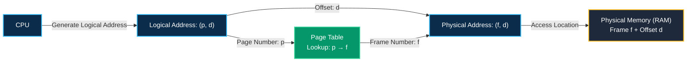
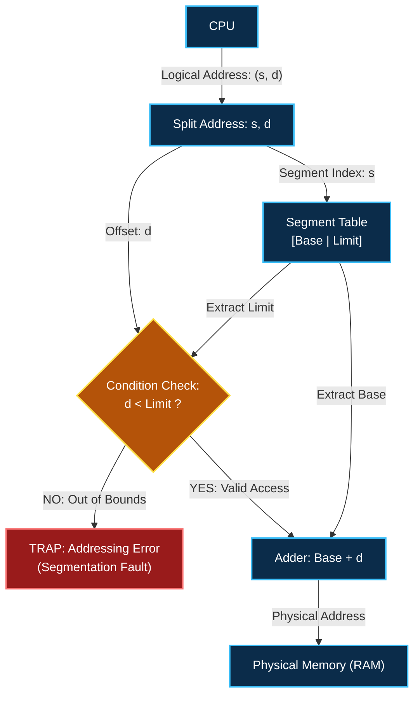

  

---

> **Quick Answer (Exam Revision Summary):** **Paging** is a non-contiguous memory management technique where the process's logical address space is divided into **fixed-size blocks called Pages**, and physical main memory (RAM) is divided into equal fixed-size blocks called **Frames**. Paging suffers from **Internal Fragmentation**, but completely eliminates External Fragmentation. In contrast, **Segmentation** divides logical memory into **variable-size blocks called Segments** based on the programmer's view of a program (e.g., Code, Stack, Data, Heap). Segmentation eliminates Internal Fragmentation, but causes **External Fragmentation**.

---

## 1. Introduction: Memory Management in Modern OS

Operating System (OS) ka ek primary responsibility hota hai: **Memory Management**. Jab bhi koi program (process) execute hota hai, CPU uske instructions ko fetch karne ke liye memory addresses generate karta hai.

Purane systems mein continuous (contiguous) memory allocation hoti thi, jisme pure process ko RAM ke ek single continuous block mein load karna padta tha. Iske do major drawbacks the:
1. **Severe External Fragmentation:** Memory mein total free space hone ke bavajood continuous space na milne par bada process load nahi ho pata tha.
2. **Limited Scalability:** Program ka size physical RAM se bada nahi ho sakta tha.

Inhi limitations ko solve karne ke liye modern operating systems **Non-Contiguous Memory Allocation** use karte hain. Iske do foundational building blocks hain: **Paging** aur **Segmentation**.

---

## 2. Deep Dive: What is Paging?

**Paging** ek hardware-supported memory management scheme hai jisme memory allocation **fixed-size chunks** mein hoti hai.

### Key Concepts of Paging:
1. **Pages (Logical Memory):** CPU dwara generated process ki logical memory ko equal fixed-size blocks mein divide kiya jata hai, jise **Pages** kehte hain (typical size: 4 KB).
2. **Frames (Physical Memory):** Main physical memory (RAM) ko bhi bilkul same size ke blocks mein divide kiya jata hai, jise **Frames** kehte hain.
3. **Page Size = Frame Size:** Page size aur frame size hamesha identical hote hain (hamesha power of 2, jaise $2^{12} = 4096\text{ bytes} = 4\text{ KB}$).
4. **Page Table:** Hardware Memory Management Unit (MMU) mein ek lookup structure hota hai jo Page Number ko corresponding Physical Frame Number se map karta hai.

### Logical Address Structure in Paging:
CPU jo logical address generate karta hai, wo do parts mein split hota hai:
$$\text{Logical Address} = \langle p, d \rangle$$
* **Page Number ($p$):** Page table ka index, jisse pata chalta hai ki ye page physical memory ke kaun se frame ($f$) mein mapped hai.
* **Page Offset ($d$):** Specific byte/word ka displacement within that page. Physical frame mein bhi offset $d$ exactly same rehta hai.

Physical address calculate karne ka formula:
$$\text{Physical Address} = (f \times \text{Frame Size}) + d$$

### Internal Fragmentation in Paging:
Paging mein **External Fragmentation kabhi nahi hoti**, kyunki koi bhi free frame kisi bhi page ko assign ho sakta hai. 

Lekin paging mein **Internal Fragmentation** hoti hai. 
* *Example:* Maan lijiye Page size 4 KB hai aur ek process ko 13 KB memory chahiye.
* OS process ko 4 pages allocate karega ($4 \times 4\text{ KB} = 16\text{ KB}$).
* Pehle 3 pages pure use honge ($3 \times 4\text{ KB} = 12\text{ KB}$).
* Chauthe (last) page mein sirf 1 KB data hoga, aur remaining 3 KB memory unused waste ho jayegi. Ye unallocated space inside an allocated block **Internal Fragmentation** kehlaati hai.

---

## 3. Deep Dive: What is Segmentation?

**Segmentation** ek memory management scheme hai jo **programmer ke logical view** ke according memory allocate karti hai.

Programmer ek program ko continuous binary stream ki tarah nahi dekhta; balki modules ki collection ki tarah dekhta hai:
* Main function (`main()`)
* Subroutines / Methods
* Global variables & Data segment
* Call Stack (function calls & local variables)
* Heap (dynamic `malloc` memory)

### Key Concepts of Segmentation:
1. **Variable Size:** Har segment ka size fix nahi hota. Code segment ka size alag hoga, Stack ka alag, aur Data segment ka alag.
2. **Segment Table:** Har process ka ek **Segment Table** hota hai jisme do critical values hoti hain:
   * **Base Address:** Physical memory mein segment ka starting physical address.
   * **Limit (Length):** Us specific segment ki exact total length.

### Logical Address Structure in Segmentation:
CPU dwara generated address contains:
$$\text{Logical Address} = \langle s, d \rangle$$
* **Segment Number ($s$):** Segment table ka index.
* **Segment Offset ($d$):** Segment ke andar ka byte displacement.

### Hardware Protection Check:
Paging ke opposite, Segmentation mein hardware address translation ke time limit check perform karta hai:
* If $d < \text{Limit}$: Valid address. $\text{Physical Address} = \text{Base} + d$.
* If $d \ge \text{Limit}$: Addressing violation! CPU hardware trap trigger karta hai (**Segmentation Fault**).

### External Fragmentation in Segmentation:
Segments ka size dynamic aur variable hone ki wajah se, jab processes memory mein load aur unload hote hain, RAM chote-chote non-contiguous free holes mein divide ho jati hai. Isse **External Fragmentation** kehte hain, jise fix karne ke liye expensive **Compaction** ya dynamic memory allocation algorithms (First-Fit, Best-Fit, Worst-Fit) ki zaroorat padti hai.

---

## 4. Hardware Implementation & Address Translation (Mermaid Diagrams)

### Paging Address Translation Architecture:
The diagram below shows how the CPU logical address is divided into page number ($p$) and offset ($d$), looked up in the Page Table, and translated into a physical memory address:

---

### Segmentation Address Translation Architecture with Limit Check:
The flowchart below illustrates how the MMU validates the offset ($d$) against the segment limit before generating the physical memory address:

---

## 5. Comprehensive Comparison Table: Paging vs Segmentation

B.Tech semester exams and technical interviews mein ye comparative table sabse high-scoring topics mein se ek hai:

| Parameter / Feature | Paging | Segmentation |
| :--- | :--- | :--- |
| **Basic Concept** | Memory is divided into fixed-size units. | Memory is divided into variable-size logical units. |
| **Unit Name** | Logical: **Page**, Physical: **Frame** | Logical unit: **Segment** |
| **Block Size** | **Fixed** (determined by hardware/architecture, e.g., 4 KB). | **Variable** (depends on the size of user function/module). |
| **Programmer Visibility** | **Invisible** (pure hardware & OS abstraction). | **Visible** (corresponds to user modules, functions, arrays). |
| **Address Representation** | Single linear number parsed as $\langle p, d \rangle$. | Two components specified by user/compiler: $\langle s, d \rangle$. |
| **Mapping Mechanism** | **Page Table** maps Page Number $\to$ Frame Number. | **Segment Table** contains Base Address and Limit length. |
| **Fragmentation Type** | **Internal Fragmentation** occurs; Zero External Fragmentation. | **External Fragmentation** occurs; Zero Internal Fragmentation. |
| **Memory Protection** | Read, Write, Execute bits per page. | Protection bits naturally aligned with logical modules (e.g., Read-Only for Code). |
| **Access Speed** | Faster address calculation (bit-shifting offset bits). | Slightly slower due to explicit addition $(\text{Base} + d)$ and comparison $(d < \text{Limit})$. |
| **Swapping Overhead** | Easy and uniform swapping (all chunks are equal). | Complex memory placement (requires Best-Fit, First-Fit algorithms). |

---

## 6. Advantages & Disadvantages Summary

### Advantages of Paging:
1. **No External Fragmentation:** Main memory mein kisi bhi free frame ko kisi bhi page ke liye allot kiya ja sakta hai.
2. **Simplified Allocation:** Hardware memory allocation algorithm constant-time $O(1)$ lookup hota hai.
3. **Efficient Virtual Memory:** Virtual memory aur demand paging ko implement karna extremely straightforward hota hai.

### Disadvantages of Paging:
1. **Internal Fragmentation:** Process ke aakhri page mein unused space waste ho jata hai.
2. **Page Table Memory Overhead:** Har process ke liye page table store karni padti hai. 64-bit systems mein Multi-level Paging ya Inverted Page Tables ki zaroorat padti hai.
3. **Memory Access Latency:** Page table RAM mein hone ki wajah se har data fetch ke liye 2 memory accesses lagte hain (jise **TLB - Translation Lookaside Buffer** se optimize kiya jata hai).

---

### Advantages of Segmentation:
1. **No Internal Fragmentation:** Segment ka size exact module size ke barabar allocate hota hai, isliye block ke andar space waste nahi hoti.
2. **Logical Alignment:** Modules, functions, aur data structures naturally separate rehte hain, jisse code sharing aur dynamic linking simple ho jati hai.
3. **Granular Security:** Code segment ko pure Read-Only banaya ja sakta hai aur Data segment ko Read-Write, preventing code injection exploits.

### Disadvantages of Segmentation:
1. **Severe External Fragmentation:** Free memory chhote-chhote disconnected fragments mein split ho jati hai, jisse memory compaction ki costly processing lagti hai.
2. **Complex Allocation Algorithms:** Free spaces ko track karne ke liye Best-Fit, Worst-Fit, ya First-Fit jaise complex memory management logic lagte hain.

---

## 7. The Modern Solution: Segmented Paging

Practical modern operating systems (jaise Linux aur Windows running on x86/ARM processors) in dono techniques ko combine karke **Segmented Paging (Paging with Segmentation)** use karte hain:
1. Program ko logical segments mein divide kiya jata hai (User-level modularity).
2. Har individual segment ko further fixed-size pages mein divide kiya jata hai (Hardware-level fragmentation control).

Is hybrid approach se dono architectures ke best advantages milte hain: user ko modular segmentation milta hai, aur physical RAM ko zero external fragmentation ke sath fixed frames mein allocate kiya ja sakta hai.

---

## 8. Conclusion

Paging aur Segmentation Operating Systems ke core memory virtualization mechanisms hain. Paging physical hardware efficiency aur zero external fragmentation par focus karti hai, jabki Segmentation logical modularity aur user-level protection par focus karti hai. 

---

*Note: While our primary focus and success stories are based in Bihar, VYOMARC Technologies provides remote engineering and digital services to businesses all across India.*

## Recommended Next Study

* To understand how lower-level network packets encapsulate and traverse across hardware interfaces, read our complete guide on the [OSI Reference Model: 7 Layers Explained with Architecture](osi-reference-model-7-layers-explained.html "OSI Reference Model 7 Layers Explained with Protocols and Architecture").
* To master database table design and eliminate redundant data anomalies in enterprise software, explore our detailed tutorial on [DBMS Normalization (1NF, 2NF, 3NF, BCNF) with Examples](what-is-normalization-1nf-2nf-3nf-bcnf-with-examples-dbms.html "Database Normalization Guide with Real Schema Examples").
