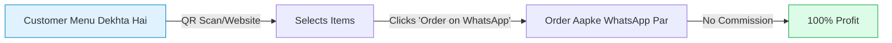

  

---

> **Quick Summary:** अगर आप बिहार शरीफ (Bihar Sharif) में रेस्टोरेंट, कैफे, बेकरी या क्लाउड किचन चलाते हैं, तो हर महीने ऑनलाइन डिलीवरी एग्रीगेटर्स को 25% से 30% कमीशन देना आपके मुनाफे को खत्म कर रहा है। **WhatsApp Ordering System** की मदद से आपके कस्टमर सीधे आपके मेन्यू को देखकर एक क्लिक में WhatsApp पर ऑर्डर प्लेस कर सकते हैं — बिना किसी तीसरे ऐप, बिना किसी कमीशन और 100% मुनाफे के साथ।

---

अगर आप बिहार शरीफ के रामचंद्रपुर, अस्पताल मोड़, रांची रोड, मोगलकुआं या भराव पर पर कोई रेस्टोरेंट या कैफे चलाते हैं, तो यह दर्द आप बखूबी समझते होंगे।

सुबह से रात तक आपकी किचन में शेफ पसीना बहाते हैं, आप रॉ मैटेरियल का खर्च उठाते हैं, बिजली का बिल भरते हैं, स्टाफ को सैलरी देते हैं। लेकिन जब शाम को ऑनलाइन डिलीवरी का हिसाब होता है, तो पता चलता है कि आपके खून-पसीने की कमाई का लगभग एक-तिहाई हिस्सा डिलीवरी एग्रीगेटर्स (Zomato/Swiggy) के कमीशन में चला गया।

सबसे बड़ी विडंबना यह है कि जो कस्टमर आपके बिरयानी, पिज्जा या रोल का दीवाना है, वह भी उसी एग्रीगेटर ऐप से ऑर्डर करता है — और हर बार उसी रेगुलर कस्टमर के ऑर्डर पर आपको 30% की चपत लगती है।

क्या यह फेयर बिजनेस है? बिल्कुल नहीं। 

अब वक्त आ गया है कि बिहार शरीफ के फूड बिजनेस ओनर्स अपने कस्टमर्स पर अपना हक वापस लें।

---

## 30% Commission का कड़वा सच (The Harsh Math)

आइए सीधे गणित की बात करते हैं, बिना किसी लाग-लपेट के:

मान लीजिए आपके रेस्टोरेंट में रोज सिर्फ 20 ऑनलाइन ऑर्डर आते हैं, और हर ऑर्डर की एवरेज वैल्यू ₹400 है।

* **डेली ऑनलाइन सेल:** ₹8,000
* **महीने की कुल ऑनलाइन सेल:** ₹2,40,000

अब देखिए कमीशन का खेल:
* **30% एग्रीगेटर कमीशन:** ₹72,000 हर महीने!
* **सालाना कमीशन का नुकसान:** **₹8,64,000**

₹8.6 लाख रुपये सालाना! इस पैसे से आप अपने रेस्टोरेंट का इंटीरियर नया कर सकते थे, एक नई ब्रांच खोल सकते थे या अपने किचन की क्षमता दोगुनी कर सकते थे। इसके बजाय, यह पैसा उन प्लेटफॉर्म्स की जेब में जाता है जो आपके ही इलाके के कस्टमर्स को आपके ही खाने पर 30% टैक्स लगाकर बेच रहे हैं।

अगर आप देखना चाहते हैं कि आपकी जेब से हर महीने कितना कमीशन लीक हो रहा है, तो हमारे फ्री [Commission Loss Calculator](../../tools/commission-calculator/index.html) पर जाकर सिर्फ 30 सेकंड में अपना लाइव लॉस कैलकुलेट करें।

---

## अपना WhatsApp Ordering System क्या है?

व्हाट्सएप ऑर्डरिंग सिस्टम कोई भारी-भरकम, मुश्किल सॉफ्टवेयर नहीं है। यह आपके और आपके कस्टमर के बीच का सबसे सीधा और आसान डिजिटल पुल (Digital Bridge) है।

यह कैसे काम करता है?
1. **QR कोड या डायरेक्ट लिंक:** आपके डाइन-इन टेबल पर, डिलीवरी बॉक्स पर या सोशल मीडिया पर एक सिंपल QR कोड या लिंक होता है।
2. **स्मार्ट डिजिटल मेन्यू:** कस्टमर अपने फोन से उस पर टैप करता है, और बिना किसी ऐप को डाउनलोड किए सेकंड भर में आपकी पूरी फूड लिस्ट, फोटो और लाइव प्राइसिंग खुल जाती है।
3. **सिंपल कार्ट और चेकआउट:** कस्टमर आइटम्स चुनता है (जैसे: 1x चिकन बिरयानी, 2x बटर नान), अपना डिलीवरी एड्रेस डालता है और "Order on WhatsApp" पर क्लिक करता है।
4. **सीधा किचन में ऑर्डर:** आपके फोन या बिलिंग काउंटर के व्हाट्सएप पर एक सुंदर, फॉर्मेटेड ऑर्डर रसीद तुरंत आ जाती है, जिसमें कस्टमर का नाम, फोन नंबर, एड्रेस और टोटल बिल लिखा होता है।
5. **डायरेक्ट UPI पेमेंट:** कस्टमर आपके काउंटर के Google Pay/PhonePe QR पर सीधे 100% पेमेंट करता है। 

बीच में कोई बिचौलिया नहीं। कोई कमीशन नहीं। पूरा 100% पैसा उसी दिन, उसी पल सीधे आपके बैंक खाते में।

---

---

## बिहार शरीफ में लोग क्या सर्च करते हैं? (The Local Search Demand)

बहुत से रेस्टोरेंट ओनर्स को लगता है कि ऑनलाइन कस्टमर सिर्फ फूड एप्स पर ही खाना ढूंढते हैं। यह एक बहुत बड़ा भ्रम है।

आज बिहार शरीफ में हर महीने हजारों लोग सीधे Google पर सर्च करते हैं:
* *"Best restaurant in Bihar Sharif"*
* *"Food delivery near Ramchandrapur Biharsharif"*
* *"Family restaurant Ranchi Road"*
* *"Late night food delivery Bihar Sharif"*

जब कोई भूखा कस्टमर गूगल पर यह सर्च करता है और आपके पास आपकी खुद की फास्ट लोडिंग वेबसाइट और डायरेक्ट व्हाट्सएप ऑर्डरिंग लिंक होता है, तो वह सीधे आपके पास पहुंचता है। 

अगर आपके पास अपनी डिजिटल प्रेजेंस नहीं है, तो गूगल उस कस्टमर को या तो एग्रीगेटर के पास भेज देता है या आपके किसी ऐसे कॉम्पिटिटर के पास जो पहले से ऑनलाइन मौजूद है। जैसा कि हमने अपनी विस्तृत केस स्टडी [Restaurant Website Design Bihar Sharif: 30% Commission Bachao](restaurant-website-design-bihar-sharif-30-percent-commission.html) में समझाया था, लोकल सर्च ट्रैफिक को कैप्चर करना आपके रेस्टोरेंट के लिए गेम-चेंजर साबित होता है।

---

## VYOMARC कैसे मदद करेगा? (The Engineering Solution)

बिहार शरीफ में स्थित **VYOMARC Technologies** लोकल रेस्टोरेंट्स और कैफेज के लिए कस्टमाइज्ड, जीरो-कमीशन व्हाट्सएप कॉमर्स सिस्टम्स तैयार करता है।

हम आपको सिर्फ एक दिखावटी वेबसाइट नहीं देते, बल्कि एक पूरा वर्किंग ऑर्डरिंग इंजन देते हैं:
* **जीरो कमीशन गारंटी:** हम आपके किसी भी ऑर्डर पर एक पैसा कमीशन नहीं लेते। आपका धंधा, आपकी कमाई।
* **अल्ट्रा-फास्ट मोबाइल मेन्यू (PWA):** 2G/3G नेटवर्क पर भी 1 सेकंड में खुलने वाला डिजिटल मेन्यू, ताकि कस्टमर कभी फ्रस्ट्रेट होकर पेज बंद न करे।
* **कस्टमर डेटा आपका अपना:** एग्रीगेटर्स आपको आपके कस्टमर का असली फोन नंबर कभी नहीं देते। हमारे सिस्टम में हर कस्टमर का फोन नंबर सीधे आपकी डायरी और व्हाट्सएप में सेव होता है, जिससे आप त्योहारों पर उन्हें सीधे ऑफर्स भेज सकते हैं।
* **टेबल QR और टेकअवे सपोर्ट:** डाइन-इन कस्टमर्स भी टेबल पर बैठे-बैठे मेन्यू देख सकते हैं और सीधे ऑर्डर कर सकते हैं।
* **बिजनेस ऑटोमेशन इंटीग्रेशन:** अगर आप बल्क कस्टमर मैसेजिंग और ऑटोमेटेड रिप्लाई सेटअप करना चाहते हैं, तो हमारी [WhatsApp Business Automation Services](../../whatsapp-business-automation.html) आपके पूरे ऑर्डर फ्लो को ऑटोपायलट पर डाल देती है।

---

## अब कमीशन गंवाना बंद कीजिए (Stop Leaking Profits)

बिहार शरीफ के रेस्टोरेंट मार्केट में कॉम्पिटिशन रोज बढ़ रहा है। ऐसे में जो रेस्टोरेंट ओनर अपनी डिलीवरी कॉस्ट को कंट्रोल करेगा और अपने रिपीट कस्टमर्स का लॉयल्टी डेटा अपने पास रखेगा, वही आने वाले सालों में टिक पाएगा और मुनाफा कमाएगा।

कस्टमर आपका है। खाना आपका है। डिलीवरी आपकी टीम करती है। तो फिर 30% कमीशन किसी अनजान कंपनी को क्यों देना?

अपने रेस्टोरेंट को डिजिटल बनाइए, बिचौलियों से आजादी पाइए और हर ऑर्डर पर 100% मुनाफा कमाना शुरू कीजिए। अगर आप स्टेप-बाय-स्टेप सिस्टम समझना चाहते हैं, तो हमारा विस्तृत गाइड [WhatsApp से ऑर्डर कैसे लें? ज़ीरो कमीशन ऑर्डर सिस्टम](whatsapp-se-order-kaise-len-business-guide.html) ज़रूर पढ़ें।

क्या आप अपने रेस्टोरेंट के लिए एक लाइव वर्किंग डेमो देखना चाहते हैं? [VYOMARC टीम से तुरंत संपर्क करें](../../contactus.html) और अपने रेस्टोरेंट के लिए फ्री कंसल्टेशन और लाइव डेमो बुक करें।
