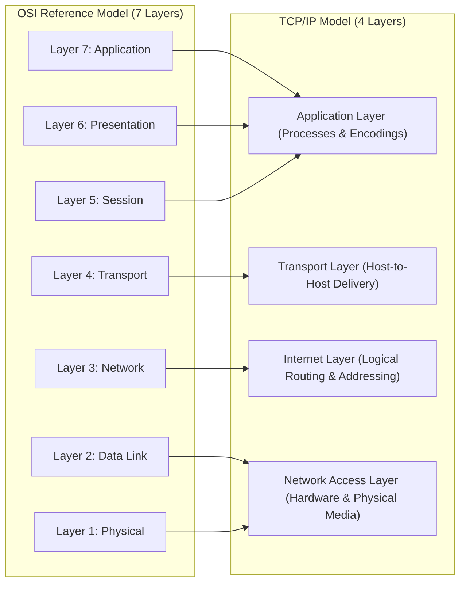
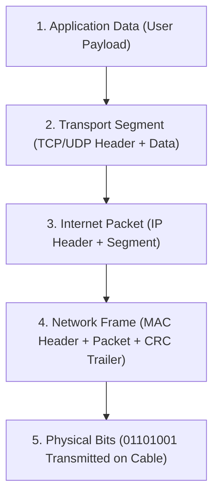

 

## Definition of TCP/IP Model

The TCP/IP (Transmission Control Protocol / Internet Protocol) Model is a concise, four-layer architectural framework that establishes the foundational communication protocols of the global Internet. Developed prior to the theoretical OSI model, it defines practical standards for packet-switched networking, reliable host-to-host delivery, and internetwork routing. By abstracting lower-level physical transmission from higher-level software services, the model allows diverse computer systems worldwide to exchange data deterministically across heterogeneous physical networks.

* **Full Form:** Transmission Control Protocol / Internet Protocol suite.
* **History:** Developed in the 1970s by the Defense Advanced Research Projects Agency (DARPA) and the United States Department of Defense (DoD) for ARPANET.
* **Purpose:** Serves as the open, universal communication standard governing data routing, transport, and application delivery across the modern Internet.
* **Number of Layers:** Composed of four practical hierarchical layers: Network Access (Link), Internet, Transport, and Application Layer.
* **Difference from OSI:** While the OSI model is a 7-layer theoretical conceptual guide, the TCP/IP model is a 4-layer functional implementation protocol suite deployed directly inside modern operating system network stacks.

---

## OSI vs TCP/IP Model

Understanding the relationship between the OSI reference model and the TCP/IP suite is one of the most critical topics in computer networking examinations. The seven theoretical layers of the OSI model map directly into the four practical layers of the TCP/IP model:

1. **Upper Layer Consolidation:** The Application, Presentation, and Session Layers of the OSI model are consolidated into a single **Application Layer** in TCP/IP.
2. **End-to-End Transport Continuity:** The Transport Layer of the OSI model corresponds directly to the **Transport Layer** (Host-to-Host) in TCP/IP.
3. **Network Routing Alignment:** The Network Layer of the OSI model corresponds directly to the **Internet Layer** in TCP/IP.
4. **Physical Media Aggregation:** The Data Link Layer and Physical Layer of the OSI model merge into the unified **Network Access Layer** (Link Layer) in TCP/IP.

---

## Layers of TCP/IP Model

Each layer of the TCP/IP suite executes a focused, modular role within the communication cycle:

### 1. Network Access Layer (Link Layer)
* **Definition:**
  * The lowest tier in the TCP/IP architecture, combining the responsibilities of the OSI Physical and Data Link layers.
  * Directs the physical framing, media access control, hardware addressing, and physical signal transmission across local hardware links.
  * Interfaces directly with physical transmission conduits, network cards, and low-level device drivers.
* **Functionalities:**
  * **Framing & Physical Addressing:** Encases IP packets into network frames and embeds 48-bit hardware MAC addresses.
  * **Media Access Regulation:** Coordinates channel access across shared physical links using CSMA/CD (Ethernet) or CSMA/CA (Wi-Fi).
  * **Signal Modulation:** Encodes binary frames into electrical pulses, fiber-optic light pulses, or wireless RF waves.
  * **Error Detection:** Verifies frame transmission integrity using Frame Check Sequence (FCS) cyclic redundancy checks.
* **Protocols:** Ethernet (IEEE 802.3), Wi-Fi (IEEE 802.11), Address Resolution Protocol (ARP), Reverse ARP (RARP), Point-to-Point Protocol (PPP).
* **Connection to Other Layers:** Accepts logical IP packets from the Internet Layer above, appends physical MAC headers, converts frames into raw signals, and transmits them across the physical transmission medium.

---

### 2. Internet Layer
* **Definition:**
  * The core routing tier of the TCP/IP model, corresponding directly to Layer 3 of the OSI framework.
  * Governs host-to-host logical packet delivery across disparate and interconnected networks worldwide.
  * Decouples the upper transport services from specific physical network topologies and intermediate hardware routing hops.
* **Functionalities:**
  * **Logical Addressing:** Assigns globally distinct IPv4 (32-bit) and IPv6 (128-bit) addresses to uniquely identify endpoints.
  * **Routing & Path Determination:** Calculates the optimal multi-hop forwarding trajectory for datagrams across autonomous systems.
  * **Packet Encapsulation:** Encases Transport segments with source and destination IP metadata to form routable packets.
  * **Fragmentation & Reassembly:** Slices oversized datagrams into smaller payload fragments when traversing transit links with smaller Maximum Transmission Unit (MTU) limitations.
* **Protocols:** Internet Protocol (IPv4, IPv6), Internet Control Message Protocol (ICMP), Internet Group Management Protocol (IGMP), Open Shortest Path First (OSPF), Border Gateway Protocol (BGP).
* **Connection to Other Layers:** Receives sequenced segments from the Transport Layer above, wraps them with logical network headers, and passes the resulting packets to the Network Access Layer for local frame transmission.

---

### 3. Transport Layer (Host-to-Host Layer)
* **Definition:**
  * Responsible for establishing reliable, process-to-process communication between distributed host applications.
  * Bridges high-level user software routines with the underlying packet-switched routing infrastructure.
  * Isolates application protocols from the underlying complexities of logical network topologies and transmission paths.
* **Functionalities:**
  * **Port Addressing:** Utilizes 16-bit source and destination port numbers to multiplex and deliver data streams to the exact active application process (e.g., Port 443 for HTTPS, Port 22 for SSH, Port 53 for DNS).
  * **Segmentation & Sequencing:** Partitions continuous application byte streams into numbered segments to guarantee accurate in-order reassembly.
  * **Connection Management:** Supports both connection-oriented communication requiring a 3-way handshake (TCP) and low-latency connectionless datagram dispatch (UDP).
  * **Flow & Error Control:** Enforces end-to-end sliding window flow regulation and error recovery via checksum verification and selective retransmission.
* **Protocols:** Transmission Control Protocol (TCP), User Datagram Protocol (UDP), Stream Control Transmission Protocol (SCTP).
* **Connection to Other Layers:** Receives raw application payloads from the Application Layer above, segments the data stream, and delivers segments to the Internet Layer below.

---

### 4. Application Layer
* **Definition:**
  * The uppermost tier in the TCP/IP stack, integrating the functions of the OSI Application, Presentation, and Session layers.
  * Directly interfaces with running user software programs and network-aware processes.
  * Provides application developers with high-level communication primitives, cryptographic standards, and syntax definitions.
* **Functionalities:**
  * **User Network Access:** Delivers foundational network services for web browsing, secure remote access, and automated file transfers.
  * **Data Representation & Compression:** Manages syntax parsing, character encodings (ASCII, Unicode), and payload compression directly inside application software.
  * **Cryptographic Security:** Integrates transport encryption standards (TLS/SSL) directly into application communication pipelines.
  * **Distributed Name Resolution:** Resolves human-readable domain names into routable numerical IP addresses via DNS.
* **Protocols:** Hypertext Transfer Protocol (HTTP/HTTPS), File Transfer Protocol (FTP), Domain Name System (DNS), Simple Mail Transfer Protocol (SMTP), Secure Shell (SSH), Dynamic Host Configuration Protocol (DHCP), SNMP.
* **Connection to Other Layers:** Intercepts requests initiated by user software and dispatches structured messages downward to the Transport Layer for port assignment and stream segmentation.

---

## TCP/IP Data Encapsulation

Data encapsulation in the TCP/IP model is the systematic procedure where each descending layer wraps the payload from the layer above with its own control metadata (headers and trailers):

1. **User Payload:** At the **Application Layer**, the user generates raw data (such as an HTTP GET request or an SMTP message body).
2. **Segment Creation:** The **Transport Layer** appends a TCP or UDP header containing 16-bit source and destination port numbers and sequence counters, transforming the payload into a **Segment**.
3. **Packet Creation:** The **Internet Layer** attaches an IP header containing source and destination IP addresses, producing an **Internet Packet** (Datagram).
4. **Frame Creation:** The **Network Access Layer** wraps the packet with a hardware MAC header and appends a Frame Check Sequence (FCS) trailer, converting it into a **Network Frame**.
5. **Physical Bit Stream:** The network interface card (NIC) converts the completed frame into raw **Physical Bits** (0s and 1s) transmitted across copper cabling, optical glass, or radio waves.

---

## Frequently Asked Questions (FAQ)

### Why is the TCP/IP model more practical than the OSI model?
The TCP/IP model was developed alongside working code for ARPANET in response to functional implementation requirements, whereas the OSI model was drafted by committee as an abstract theoretical standard before protocols were written. Because TCP/IP was integrated directly into the Unix BSD operating system and early Internet routing hardware, it established universal adoption while OSI remained primarily an academic reference architecture.

### On which layer does the Internet Protocol (IP) operate?
The Internet Protocol (IPv4 and IPv6) operates exclusively at the **Internet Layer** (equivalent to Layer 3, the Network Layer, in the OSI framework). It provides connectionless, best-effort packet delivery across interconnected networks through logical addressing and packet routing.

### What is the fundamental difference between TCP and UDP?
TCP (Transmission Control Protocol) is a connection-oriented, reliable transport protocol that performs a 3-way handshake, verifies packet sequencing, and retransmits lost segments, making it ideal for web traffic (HTTPS) and file transfers (FTP). UDP (User Datagram Protocol) is a connectionless, lightweight protocol that transmits packets without handshake verification or retransmission overhead, providing the low-latency throughput required for live voice, video streaming, and DNS lookups.

### How do OSI 7 layers correspond to TCP/IP 4 layers?
In the TCP/IP architecture, the top three OSI layers (Application, Presentation, and Session) are integrated into a single unified Application Layer. The Transport and Network layers map directly to the Transport and Internet layers respectively. The bottom two OSI layers (Data Link and Physical) are combined into the Network Access Layer.

---

## OSI vs TCP/IP Comparison Table (Crucial for Exams)

The following side-by-side comparative matrix covers the foundational differences required for university semester examinations and technical engineering interviews:

| Metric / Parameter | OSI Reference Model | TCP/IP Model |
| :--- | :--- | :--- |
| **Number of Layers** | 7 Distinct Hierarchical Layers | 4 Practical Architectural Layers |
| **Model Type** | Theoretical Reference Benchmark | Practical Implementation Standard |
| **Layer Breakdown** | Application, Presentation, Session, Transport, Network, Data Link, Physical | Application, Transport, Internet, Network Access |
| **Protocol Dependency** | Protocol-independent (framework defined before protocols) | Protocol-dependent (model formalized after protocols were deployed) |
| **Design Approach** | Conceptual, top-down clean architectural separation | Practical, bottom-up implementation-first engineering |
| **Session & Presentation** | Dedicated, separate independent layers | Consolidated directly inside the Application Layer |
| **Hardware & Link** | Explicitly separated into Data Link (Layer 2) and Physical (Layer 1) | Combined into a single Network Access Layer |
| **Reliability Model** | Supports connection-oriented and connectionless at both Network and Transport | Connectionless at Internet layer (IP); choice of TCP/UDP at Transport layer |
| **Usage & Deployment** | Educational reference model and hardware engineering specification | Operational architecture powering the global Internet |

---

## Conclusion & Next Topic

The TCP/IP model stands as the architectural foundation of modern computer networking. By streamlining communication into four robust, protocol-driven layers, it ensures that diverse operating systems, computing devices, and networking switches can communicate with absolute reliability across the worldwide Internet.

To compare this practical implementation with the theoretical 7-layer framework, revisit our comprehensive guide on the **[OSI Reference Model](osi-reference-model-computer-network.html)**.

Next Topic: Learn about [IP Addressing in Computer Networks](ip-addressing-computer-networks.html).

---

## 🏢 About VYOMARC Technologies

**VYOMARC Technologies** is an engineering-first software architecture and digital technology company based in Ramchandarpur, Bihar Sharif, Nalanda, Bihar (PIN 803216). We engineer production-grade enterprise software, custom high-performance web systems, and secure institutional platforms.

* **Office Address:** Ramchandarpur, Bihar Sharif, Nalanda, Bihar - 803216
* **Email:** vyomarctechnologies@gmail.com
* **Call / WhatsApp:** +91 825 270 2699
* **Operational Hours:** Mon-Sat, 10:00 AM to 4:00 PM

