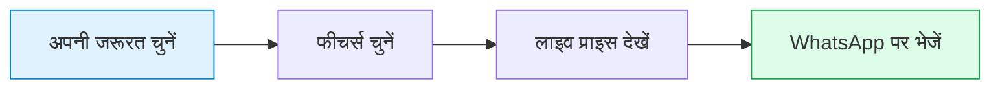

  

---

> **त्वरित सारांश (Quick Summary):** जब भी किसी एजेंसी या फ्रीलांसर से वेबसाइट की कीमत पूछो, तो सीधे दाम बताने के बजाय लंबी बातचीत और घुमावदार जवाब मिलते हैं। VYOMARC Technologies ने इस पुरानी समस्या को खत्म करने के लिए **Instant Quote Estimator** बनाया है। अब आप बिना किसी को कॉल किए, अपनी पसंद के फीचर्स चुनकर 60 सेकंड में लाइव और पारदर्शी बजट जान सकते हैं।

---

जब भी हम किसी वेब डेवलपर को फोन करते हैं, तो पहला सवाल आता है: 'सर, खर्चा कितना आएगा?' और जवाब मिलता है: 'ये तो आपकी रिक्वायरमेंट पर डिपेंड करता है।' ये अनिश्चितता हमें परेशान करती है।

अक्सर बिज़नेस मालिकों के साथ यही होता है। कोई एजेंसी ₹5,000 बताती है, कोई ₹50,000 मांगती है और अंत में कई छिपे हुए चार्जेस जोड़ दिए जाते हैं। जब तक आप डेवलपर से लंबी बात न कर लें, तब तक यह समझना मुश्किल हो जाता है कि आखिर वेबसाइट बनवाने का वाजिब खर्च क्या होना चाहिए।

इसी असमंजस की वजह से बहुत से दुकानदार, स्कूल, कोचिंग संस्थान और व्यापारी अपनी वेबसाइट बनवाने का फैसला टालते रहते हैं।

---

## अब इंतज़ार खत्म: पेश है Instant Quote Estimator

VYOMARC लाया है एक फ्री **Instant Quote Estimator**। आप अपनी जरूरत के हिसाब से ऑप्शन चुनें और तुरंत अपनी वेबसाइट का अनुमानित खर्चा देखें।

अब आपको रेट जानने के लिए किसी सेल्समैन के कॉल का इंतज़ार करने या अपनी ईमेल आईडी रजिस्टर करने की कोई ज़रूरत नहीं है। हमारी वेबसाइट के टूल्स सेक्शन में जाइए, अपनी पसंद के विकल्प चुनिए और स्क्रीन पर तुरंत अपनी वेबसाइट की सही लागत देखिए।

👉 **[अपना एस्टीमेट निकालें](/tools/quote-estimator/index.html)**

---

---

## ये टूल कैसे काम करता है?

हमारा एस्टीमेटर इस्तेमाल करना बेहद आसान है। इसे केवल 3 सरल चरणों में डिज़ाइन किया गया है:

### स्टेप 1: अपनी जरूरत चुनें
सबसे पहले तय करें कि आपको किस तरह की वेबसाइट चाहिए:
* **Landing Page:** सिंगल पेज वेबसाइट, जो नए प्रोडक्ट्स या लीड जनरेशन के लिए बेहतरीन है।
* **3-Page Website:** होम, अबाउट और संपर्क पेज के साथ छोटे लोकल बिज़नेस के लिए एकदम सही।
* **5-Page Website:** कॉर्पोरेट और पेशेवर कंपनियों के लिए पूरी जानकारी वाली वेबसाइट।
* **Progressive Web App (PWA):** मोबाइल ऐप जैसा तेज़ अनुभव देने वाली आधुनिक वेब ऐप्लिकेशन।

### स्टेप 2: अपना बिज़नेस और जरूरी फीचर्स चुनें
अपनी इंडस्ट्री चुनें (जैसे रिटेल, रेस्टोरेंट, कोचिंग या हेल्थकेयर) और वही फीचर्स जोड़ें जिनकी आपको ज़रूरत है:
* डायरेक्ट WhatsApp ऑर्डरिंग और चैट बटन
* इंटरैक्टिव गूगल मैप्स और लोकेशन पिन
* इंक्वायरी फॉर्म और लीड कैप्चर सिस्टम
* कंटेंट अपडेट करने के लिए आसान एडमिन पैनल

### स्टेप 3: लाइव कीमत देखें और WhatsApp पर शेयर करें
जैसे ही आप किसी फीचर पर क्लिक करते हैं, स्क्रीन पर दाईं ओर लाइव प्राइस तुरंत अपडेट हो जाता है। आप चाहें तो अपना पूरा कोटेशन एक क्लिक में पीडीएफ (PDF) के रूप में डाउनलोड कर सकते हैं या सीधे हमारी इंजीनियरिंग टीम को WhatsApp पर भेजकर तुरंत काम शुरू करवा सकते हैं।

---

## पारदर्शी कीमत (Transparent Pricing)

हम छिपी फीस में विश्वास नहीं करते। हमारा टूल आपको शुरुआती कीमत (Landing Page ₹5,999 से) से लेकर एडवांस फीचर्स (जैसे Admin Panel ₹5,000) तक सब कुछ साफ-साफ बताता है।

पारंपरिक एजेंसियों में अक्सर काम शुरू होने के बाद होस्टिंग, बैकअप और मेंटेनेंस के नाम पर अतिरिक्त पैसे मांगे जाते हैं। लेकिन VYOMARC में सब कुछ पहले दिन से शीशे की तरह साफ रहता है:

* **100% कोड ओनरशिप:** वेबसाइट का पूरा कोड आपका अपना होता है। कोई मासिक किराया नहीं।
* **सुपरफास्ट स्पीड:** मोबाइल पर 1 सेकंड से कम समय में लोड होने वाला कोड।
* **सालाना रिन्यूअल की पूरी जानकारी:** डोमेन और क्लाउड होस्टिंग का हिसाब बिल्कुल स्पष्ट।

यदि आप अपनी कंपनी के लिए कस्टम कोडिंग और एंटरप्राइज आर्किटेक्चर बनवाना चाहते हैं, तो हमारी विस्तृत [Website Development Services](/website-development-services-bihar.html) भी देख सकते हैं।

---

## क्यों ये टूल आपके काम का है?

1. **समय बचता है:** बिना किसी मीटिंग या फोन कॉल के सिर्फ 60 सेकंड में आपको सही बजट का अंदाज़ा लग जाता है।
2. **कोई सेल्समैन परेशान नहीं करता:** आपको अपना फोन नंबर डालकर ओटीपी का इंतज़ार नहीं करना पड़ता। टूल पूरी तरह ओपन और फ्री है।
3. **बजट पहले से तय होता है:** आप अपनी जेब और प्राथमिकता के हिसाब से फीचर्स चुन सकते हैं और गैर-ज़रूरी खर्चों से बच सकते हैं।
4. **मार्केट रेट की समझ मिलती है:** अगर आप किसी दूसरे डेवलपर से भी बात कर रहे हैं, तो आपके पास एक ठोस आधार होता है कि किस फीचर की सही कीमत क्या होनी चाहिए।

---

## निष्कर्ष: आज ही निकालें अपना एस्टीमेट

डिजिटल दुनिया में आगे बढ़ने के लिए पहली शुरुआत सही जानकारी से होती है। अब अंदाज़ों और असमंजस में समय गंवाना बंद कीजिए। 

आज ही अपनी वेबसाइट का अंदाजा लगाएं और अपना डिजिटल सफर शुरू करें।

👉 **[Free Estimator Tool](/tools/quote-estimator/index.html)** पर जाएं, अपनी ज़रूरतें चुनें और अपनी ड्रीम वेबसाइट का तुरंत लाइव कोटेशन पाएं।
