 

---

> **Quick Summary for Semester Exams:** **Normalization** is a systematic, step-by-step technique in Database Management Systems (DBMS) used to organize relational tables to **minimize data redundancy** (duplication) and eliminate undesirable **anomalies** (Insertion, Deletion, and Updation). It proceeds hierarchically from **1NF** (Atomic values) → **2NF** (No partial dependency) → **3NF** (No transitive dependency) → **BCNF** (Every determinant is a super key).

---

## 1. What is Normalization in DBMS?

In relational database design, storing unorganized data inside a single large table leads to severe problems: massive disk space wastage, duplicate entries, and inconsistent data states when records are modified.

**Normalization** is the formal scientific process of decomposing large, redundant tables into smaller, well-structured, modular relations while preserving data relationships through foreign keys.

It was first introduced by **Dr. Edgar F. Codd** (the inventor of the Relational Model) in 1970 and later expanded with Raymond F. Boyce to establish higher normal forms.

### Primary Objectives of Normalization:
1. **Eliminate Redundant Data:** Prevent storing the same piece of information in multiple places.
2. **Prevent Database Anomalies:** Ensure seamless INSERT, UPDATE, and DELETE operations without unintended side-effects.
3. **Maintain Data Integrity:** Enforce functional dependencies and relational constraints automatically.

---

## 2. Database Anomalies (Why Normalization is Essential)

If a relational database is not properly normalized, it suffers from three primary types of anomalies. Let us understand them using an unnormalized sample table:

### Unnormalized Sample Table: `Employee_Department`

| Emp_ID | Emp_Name | Dept_ID | Dept_Name | Dept_Head |
| :--- | :--- | :--- | :--- | :--- |
| 101 | Amit Sharma | D01 | IT | Rajesh Verma |
| 102 | Priya Singh | D01 | IT | Rajesh Verma |
| 103 | Rohan Mehta | D02 | Marketing | Sunita Rao |
| 104 | Neha Gupta | D01 | IT | Rajesh Verma |

---

### A. Updation Anomaly (Update Anomaly)
* **Problem:** Data inconsistency caused by updating data in one place but missing other redundant rows.
* **Example:** If the Department Head for IT changes from *Rajesh Verma* to *Vikram Patel*, we must update all rows where `Dept_ID = 'D01'`. If we update the record for `Emp_ID = 101` and `102` but fail to update `104`, the database enters an inconsistent state where IT appears to have two different Department Heads.

### B. Insertion Anomaly
* **Problem:** Inability to record certain valid business facts without artificially creating unrelated synthetic records.
* **Example:** Suppose the organization creates a new department called **"Research & Development" (D03)** under head *Dr. Sen*, but has not yet hired any employees for it. Because `Emp_ID` is the primary key, we cannot insert this department into the table with a `NULL` employee ID without violating entity integrity constraints.

### C. Deletion Anomaly
* **Problem:** Unintentionally losing vital related data when deleting an unrelated record.
* **Example:** If employee `103 (Rohan Mehta)` resigns and we delete his row, we inadvertently erase the **Marketing (D02)** department and its head *Sunita Rao* from our database entirely, as it was the only record holding that department's information.

---

## 3. Step-by-Step Normal Forms Explained (with Examples)

Normalization works through progressive stages called **Normal Forms (NF)**. Each higher normal form builds upon and satisfies the conditions of all preceding normal forms.

```
Unnormalized Table (UNF)
        ↓  (Remove Multi-Valued Attributes / Ensure Atomic Data)
       1NF
        ↓  (Remove Partial Functional Dependencies)
       2NF
        ↓  (Remove Transitive Functional Dependencies)
       3NF
        ↓  (Ensure Every Determinant is a Super Key)
      BCNF (Boyce-Codd Normal Form)
```

---

### 1NF (First Normal Form)

> **Strict Condition for 1NF:** 
> 1. Each column must contain only **atomic (indivisible) values**.
> 2. There must be **no multi-valued attributes** or repeating groups.
> 3. Each row must be uniquely identifiable (Primary Key defined).

#### Non-1NF Table (Violates 1NF):
In the table below, employee Amit has multiple phone numbers stored in a single cell, violating atomicity:

| Emp_ID | Emp_Name | Phone_Numbers | City |
| :--- | :--- | :--- | :--- |
| 101 | Amit Sharma | 9876543210, 8765432109 | Patna |
| 102 | Priya Singh | 9123456780 | Bihar Sharif |

#### Conversion to 1NF:
Deconstruct composite and multi-valued values so every cell contains exactly one single value:

| Emp_ID | Emp_Name | Phone_Number | City |
| :--- | :--- | :--- | :--- |
| 101 | Amit Sharma | 9876543210 | Patna |
| 101 | Amit Sharma | 8765432109 | Patna |
| 102 | Priya Singh | 9123456780 | Bihar Sharif |

*Primary Key for 1NF Table:* Composite key `{Emp_ID, Phone_Number}`.

---

### 2NF (Second Normal Form)

> **Strict Condition for 2NF:** 
> 1. The table must already be in **1NF**.
> 2. **No Partial Dependency:** No non-prime attribute should be functionally dependent on a *proper subset* of any candidate key. Every non-prime attribute must depend on the **entire** candidate key.
> 
> *(Note: If the primary key consists of a single attribute, the table is automatically in 2NF once it satisfies 1NF!)*

#### Non-2NF Table (Contains Partial Dependency):
Consider an engineering student course registration relation:
* **Composite Primary Key:** `{Student_ID, Course_ID}`
* **Non-prime attributes:** `Student_Name`, `Course_Name`

| Student_ID (PK) | Course_ID (PK) | Student_Name | Course_Name |
| :--- | :--- | :--- | :--- |
| S101 | CS201 | Rahul Kumar | Data Structures |
| S101 | CS202 | Rahul Kumar | DBMS |
| S102 | CS201 | Ananya Roy | Data Structures |

#### The Partial Dependencies:
* `Student_ID → Student_Name` (`Student_Name` depends only on `Student_ID`, not on `Course_ID`).
* `Course_ID → Course_Name` (`Course_Name` depends only on `Course_ID`, not on `Student_ID`).
* Both violate 2NF because non-prime attributes depend on parts of the composite primary key.

#### Conversion to 2NF (Decomposition into 3 Relations):

1. **`Student` Table:**
   * Primary Key: `Student_ID`

| Student_ID | Student_Name |
| :--- | :--- |
| S101 | Rahul Kumar |
| S102 | Ananya Roy |

2. **`Course` Table:**
   * Primary Key: `Course_ID`

| Course_ID | Course_Name |
| :--- | :--- |
| CS201 | Data Structures |
| CS202 | DBMS |

3. **`Enrollment` Table:**
   * Composite Primary Key: `{Student_ID, Course_ID}`

| Student_ID | Course_ID |
| :--- | :--- |
| S101 | CS201 |
| S101 | CS202 |
| S102 | CS201 |

---

### 3NF (Third Normal Form)

> **Strict Condition for 3NF:** 
> 1. The table must be in **2NF**.
> 2. **No Transitive Dependency:** No non-prime attribute should be determined by another non-prime attribute ($A \to B \to C$).
> 
> **Formal Rule:** For every non-trivial functional dependency $X \to Y$, at least ONE of the following must be true:
> * $X$ is a **Super Key**, OR
> * $Y$ is a **Prime Attribute** (part of a candidate key).

#### Non-3NF Table (Contains Transitive Dependency):
Consider a project allocation table where `Emp_ID` is the Primary Key:

| Emp_ID (PK) | Emp_Name | Project_ID | Project_Name |
| :--- | :--- | :--- | :--- |
| 101 | Satyam | P01 | CBT Platform |
| 102 | Manish | P01 | CBT Platform |
| 103 | Neha | P02 | WhatsApp Engine |

#### The Transitive Dependency:
* Functional Dependencies:
  1. `Emp_ID → Project_ID` (`Emp_ID` is a Super Key — Valid)
  2. `Project_ID → Project_Name` (Here `Project_ID` is **NOT** a super key, and `Project_Name` is **NOT** a prime attribute!)
* Therefore: `Emp_ID → Project_ID → Project_Name` is a **transitive dependency**, violating 3NF.

#### Conversion to 3NF (Decomposition into 2 Relations):

1. **`Employee` Table:**
   * Primary Key: `Emp_ID`, Foreign Key: `Project_ID`

| Emp_ID | Emp_Name | Project_ID |
| :--- | :--- | :--- |
| 101 | Satyam | P01 |
| 102 | Manish | P01 |
| 103 | Neha | P02 |

2. **`Project` Table:**
   * Primary Key: `Project_ID`

| Project_ID | Project_Name |
| :--- | :--- |
| P01 | CBT Platform |
| P02 | WhatsApp Engine |

---

### BCNF (Boyce-Codd Normal Form / 3.5NF)

> **Strict Condition for BCNF:** 
> 1. The table must be in **3NF**.
> 2. **Strict Determinant Rule:** For every non-trivial functional dependency $X \to Y$, **$X$ MUST strictly be a Super Key**.

#### Why do we need BCNF when we have 3NF?
In 3NF, a dependency $X \to Y$ is permitted if $Y$ is a **prime attribute**, even when $X$ is **not a super key**. While rare, this loophole still allows redundant data anomalies when a table has overlapping candidate keys. BCNF closes this loophole by removing the "$Y$ is prime attribute" clause entirely.

#### Non-BCNF Table (Valid in 3NF, but Violates BCNF):
Consider a tutoring system where:
* A student can take multiple subjects.
* For each subject, multiple professors can teach.
* **Each professor teaches only ONE subject.**

| Student (PK) | Subject (PK) | Professor |
| :--- | :--- | :--- |
| Aayush | Physics | Dr. Verma |
| Ankit | Physics | Dr. Verma |
| Aayush | Chemistry | Dr. Sharma |

* **Candidate Keys:** `{Student, Subject}` and `{Student, Professor}`
* **Prime Attributes:** `Student`, `Subject`, `Professor`
* **Functional Dependencies:**
  1. `{Student, Subject} → Professor` (LHS is a Super Key — Satisfies BCNF)
  2. `Professor → Subject` (LHS `Professor` is **NOT** a Super Key! However, `Subject` is a Prime Attribute, so it passed 3NF, but **violates BCNF**!)

#### Conversion to BCNF (Decomposition):

1. **`Professor_Subject` Table:**
   * Primary Key: `Professor` (Now `Professor` is a Super Key!)

| Professor | Subject |
| :--- | :--- |
| Dr. Verma | Physics |
| Dr. Sharma | Chemistry |

2. **`Student_Professor` Table:**
   * Composite Primary Key: `{Student, Professor}`

| Student | Professor |
| :--- | :--- |
| Aayush | Dr. Verma |
| Ankit | Dr. Verma |
| Aayush | Dr. Sharma |

---

## 4. Key Differences: 3NF vs BCNF

| Feature / Criteria | 3NF (Third Normal Form) | BCNF (Boyce-Codd Normal Form) |
| :--- | :--- | :--- |
| **Formal Rule for $X \to Y$** | $X$ must be Super Key **OR** $Y$ is a Prime Attribute. | $X$ must **strictly** be a Super Key (no exceptions). |
| **Strictness** | Less strict than BCNF. | Stricter; also known as 3.5 Normal Form. |
| **Redundancy** | May still contain minimal redundancy with overlapping keys. | Completely eliminates functional dependency redundancy. |
| **Dependency Preservation**| Always guarantees dependency preservation. | May not always preserve all functional dependencies. |
| **Lossless Join** | Always achievable. | Always achievable. |

---

## 5. Summary Table: Normal Forms at a Glance

| Normal Form | Foundational Requirement | Strict Condition to Satisfy | Anomalies Eliminated |
| :--- | :--- | :--- | :--- |
| **1NF** | Relational Table | Atomic values only; no multi-valued columns. | Repeating group ambiguity |
| **2NF** | In 1NF | No Partial Dependency (all non-primes depend on full PK). | Insertion & Deletion on partial keys |
| **3NF** | In 2NF | No Transitive Dependency ($X$ is Super Key or $Y$ is Prime). | Transitive update inconsistencies |
| **BCNF** | In 3NF | For every non-trivial $X \to Y$, $X$ must be a Super Key. | Anomalies from overlapping candidate keys |

---

## 6. Advantages & Disadvantages of Normalization

Understanding the trade-offs between normalized and denormalized architectures is critical for real-world enterprise software engineering:

### Advantages
1. **Minimized Data Redundancy:** Drastically cuts down duplicate data storage across database disks.
2. **Enhanced Data Integrity:** Updates happen in a single canonical record, eliminating conflicting or stale data states.
3. **Prevention of All 3 Anomalies:** Insertion, deletion, and update operations are isolated and risk-free.
4. **Optimized Indexing and Writes:** Smaller table widths lead to compact B-Tree indices and significantly faster `INSERT`, `UPDATE`, and `DELETE` execution.

### Disadvantages
1. **Slower Read Queries (JOIN Overhead):** Because data is separated across multiple tables, complex reports and dashboards require numerous heavy SQL `JOIN` operations, increasing query latency.
2. **Increased Architectural Complexity:** More tables mean more foreign key relationships, complex constraints, and intricate schema migrations.
3. **Suboptimal for Analytics (OLAP):** In data warehousing and Business Intelligence where lightning-fast aggregations are required, teams intentionally choose **Denormalization** (Star/Snowflake schemas) to avoid expensive joins.

---

## 7. Normalization Funnel Pipeline (Mermaid Diagram)

The following diagram illustrates the systematic progression from an unnormalized table down to Boyce-Codd Normal Form:

```mermaid
flowchart LR
    UNF["Unnormalized Table (UNF)<br/>• Composite & multi-valued data"] -->|"Step 1: Enforce Atomic Values<br/>Remove repeating groups"| N1["1NF (First Normal Form)<br/>• Atomic attributes only<br/>• Primary key assigned"]
    N1 -->|"Step 2: Eliminate Partial Dependency<br/>Non-primes depend on whole key"| N2["2NF (Second Normal Form)<br/>• Satisfies 1NF<br/>• Full functional dependency"]
    N2 -->|"Step 3: Eliminate Transitive Dependency<br/>X is Super Key or Y is Prime"| N3["3NF (Third Normal Form)<br/>• Satisfies 2NF<br/>• No non-prime determines non-prime"]
    N3 -->|"Step 4: Strict Super Key Rule<br/>For every X → Y, X is Super Key"| BCNF["BCNF (Boyce-Codd NF)<br/>• Complete redundancy elimination<br/>• All determinants are Super Keys"]

    classDef stage fill:#0b2c4a,stroke:#38bdf8,stroke-width:2px,color:#ffffff;
    classDef target fill:#059669,stroke:#34d399,stroke-width:2px,color:#ffffff;
    class UNF,N1,N2,N3 stage;
    class BCNF target;
```


