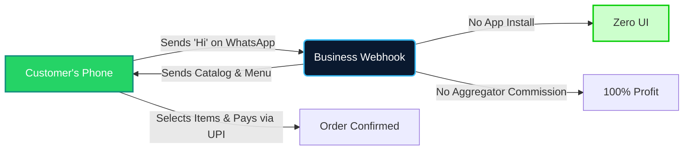

  

---

> **Quick Take:** The app store era is officially ending for local commerce. Customers are exhausted by mandatory app downloads, 15-step registration flows, and forgotten passwords. Instead, forward-thinking businesses across Patna, Bihar Sharif, and Tier-2 India are turning WhatsApp into their primary operating system—using "Zero-UI" conversational bots and instant Progressive Web Apps (PWAs) to capture direct, commission-free sales where their customers already spend their days.

---

The app store era is ending for local commerce.

Think about the last time you wanted to order a quick dinner from a neighborhood restaurant, book an appointment at a regional clinic, or buy replacement hardware from a local supplier. 

What happened? You were told to download their 85-megabyte mobile app from Google Play. Then you had to enter your phone number, wait for an OTP SMS that never arrived, verify an email address, pick a strong password, grant location permissions, and navigate five confusing screens just to see if your item was in stock.

What did you do? You closed the tab and called someone else.

Customers hate downloading new apps for single-purpose errands. Their phone storage is full, their patience is thin, and app fatigue has set in permanently. 

If your business still expects customers to install software before giving you money, you are handing your market share directly to your competitors.

---

## The "70% Drop-off" Data (The Reality Check)

Global e-commerce and retail case studies now confirm what common sense already told us: **forcing app installs kills conversion rates.**

When a business sends prospective buyers to an app store landing page, industry analytics show an immediate **70% drop-off**. Seven out of every ten interested shoppers abandon the transaction before the install button is even tapped.

Even when customers visit a traditional multi-page website, drop-offs stay brutal:
* 42% abandon if pages take more than three seconds to load over mobile networks.
* 28% drop off during forced account creation.
* Another 20% abandon at checkout when asked to re-enter billing addresses on clunky mobile forms.

Every friction point is a silent revenue leak. In regional markets where mobile users browse on mid-tier Android devices over cellular data, heavy web frameworks and bloated native apps act as invisible walls between your cash register and your buyers.

---

## What is "Zero-UI"? (The Concept)

"Zero-UI" does not mean your business has no digital interface. It means using the interface your customers already open fifty times a day: **WhatsApp**.

In a Zero-UI architecture:
1. A customer taps a link on Google or scans a QR code on your counter.
2. WhatsApp opens instantly with a pre-filled greeting message.
3. The customer hits send.
4. Your backend webhook responds in milliseconds with an interactive product catalog, live pricing, and a single-tap UPI checkout trigger.

There is no new app to download. There are no passwords to remember. There is zero interface friction to learn. 

The entire transaction happens inside a familiar conversational chat thread that your customer already trusts.

---

---

## The PWA Bridge (For Existing Websites)

What if you sell 200 different products or run a detailed food menu with custom add-ons? A pure text bot might feel cramped.

This is where the **Progressive Web App (PWA) Bridge** completely outclasses legacy native mobile apps.

When your WhatsApp webhook replies, it sends a lightweight PWA catalog link. When the customer taps it, the storefront opens directly inside WhatsApp's built-in browser container in under 400 milliseconds. 

No loading spinners. No app store redirect. It feels just as silky and responsive as a native app, but requires zero storage and zero installation. The customer picks their items, hits checkout, pays via PhonePe, Google Pay, or Paytm, and the confirmed order ticket instantly posts right back into the WhatsApp conversation.

It combines the rich visual layout of an e-commerce store with the conversational intimacy of direct messaging.

---

## The 3x Conversion Rate (The Result)

Businesses that replace clunky mobile websites and native app requirements with WhatsApp direct ordering consistently report a **3x jump in conversion rates**.

Why? The math behind conversational commerce is straightforward:
* **Zero Drop-off from Installation:** 100% of your visitors can interact immediately because everyone already has WhatsApp installed.
* **Instant Read Rates:** Over 95% of WhatsApp messages are opened within five minutes, compared to less than 20% for marketing emails and 10% for mobile push notifications.
* **Frictionless UPI Payments:** UPI deep-linking allows buyers to approve payments with two biometric taps, eliminating manually typed credit card details or failed gateway redirects.
* **Direct Customer Retention:** Every order leaves a direct, personal communication channel open between you and the buyer for automated delivery updates and reorders.

When buying from you takes fewer than three taps, customers stop hesitating and start purchasing.

---

## What this means for Bihar Businesses (The Local Angle)

This shift is not just for global D2C giants. It is having its strongest commercial impact in commercial hubs like Bihar Sharif, Patna, Gaya, and Muzaffarpur.

Regional business dynamics make WhatsApp commerce the ultimate operational weapon:
* **Smartphone Habits:** From college students to senior business owners, everyone in Bihar understands how to send a WhatsApp message and scan a QR code.
* **Aggregator Exhaustion:** Food outlets and grocery stores are tired of surrendering 25% to 30% of their top-line revenue to food delivery aggregators just to accept online orders. As we analyzed in our breakdown of [Restaurant Website Design Bihar Sharif](restaurant-website-design-bihar-sharif-30-percent-commission.html), shifting repeat customers to direct WhatsApp ordering recovers your profit margins instantly.
* **Trust & Immediacy:** Local buyers prefer dealing directly with real businesses. A WhatsApp order ticket feels personal, transparent, and dependable.

Whether you run a coaching institute collecting admission inquiries, a diagnostic lab booking home blood tests, or a restaurant managing daily takeaway orders, WhatsApp is the easiest, highest-converting sales funnel available today.

---

## How VYOMARC Builds This (The Pitch)

We are not just following this trend; we have been building it.

**We are not just following this trend; we have been building it. VYOMARC Technologies develops custom zero-commission WhatsApp ordering systems and high-performance PWAs. No third-party aggregators, no commissions. Your business, your data, your customers.**

Here is how our engineering powers your conversational commerce:
* **Custom Webhook Automation:** We connect your WhatsApp Business API directly to your private database, allowing automatic catalog rendering, stock validation, and instant receipt generation.
* **Zero Aggregator Fees:** You pay zero percentage commissions per order. Every rupee of profit stays in your bank account.
* **Instant Link Generation:** Generate customized, trackable WhatsApp click-to-chat links for your social campaigns using our free [WhatsApp Direct Order Link Generator](../../tools/whatsapp-link-generator/index.html).
* **Direct POS & Kitchen Printers:** Automated WhatsApp tickets route straight to your billing counter or thermal receipt printer without manual operator intervention.

---

## Audit Your Customer Journey Today

Run a quick audit of your business right now. 

Pretend you are a brand-new customer who just discovered your brand. How many steps, clicks, forms, and screens does it take for you to place an order or book an appointment?

If the answer is more than two steps, you are actively leaking money every day.

The businesses that dominate regional commerce over the next decade will not be the ones with the heaviest apps or the biggest marketing budgets. They will be the businesses that respect their customers' time and make buying as effortless as sending a text.

Ready to eliminate checkout friction and launch your direct WhatsApp commerce system? [Schedule a consultation with our software engineering team](../../contactus.html) and start accepting zero-commission orders this week.
