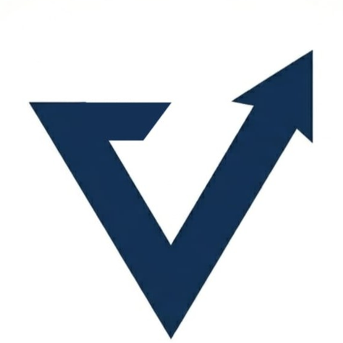

# VYOMARC Technologies - Navbar & Footer Design System

This document extracts the production-ready HTML markup, CSS rules, JavaScript handlers, and structural specifications for the global Navigation Bar and Footer across the VYOMARC Technologies web ecosystem.

---

## 1. Navigation Bar (Global)

**Description:** Floating white pill design with elevation shadow, brand identifier, center-aligned navigation links with interactive dropdown, and call-to-action consultation button.

### Navigation Tabs Structure
- **Brand:** VYOMARC Logo (`vlogo.png`) & Brand Name (`VYOMARC`)
- **Home:** `/#home`
- **About:** `about.html`
- **Services (Dropdown Menu):**
  - Website Development (`website-development-services-bihar.html`)
  - Software Development (`software-development-company-bihar.html`)
  - View All Services (`index.html#services`)
- **Work:** `/#work`
- **Article & Blogs:** `/blogs/`
- **Contact:** `contactus.html`
- **Our Clients:** `clients.html`
- **CTA Action Button:** "Get a Free Consultation" (`contactus.html`) — Desktop pill and mobile menu button

### HTML Structure
```html
<header class="navbar-wrapper">
  <nav class="nav-floating" aria-label="Main Navigation">
    <div class="nav-brand-group">
      <a href="/" class="nav-logo" aria-label="VYOMARC Home">
        
        <span class="nav-logo-text">VYOMARC</span>
      </a>
      <span class="nav-brand-divider" aria-hidden="true"></span>
    </div>

    <button type="button" class="menu-toggle" id="mobile-menu" aria-label="Toggle Menu" aria-expanded="false">
      <i class="fas fa-bars"></i>
    </button>

    <div class="nav-links" id="nav-links">
      <a href="/#home" class="nav-link-pill active">Home</a>
      <a href="about.html" class="nav-link-pill">About</a>
      <div class="nav-dropdown">
        <button type="button" class="dropdown-toggle nav-link-pill" aria-haspopup="true" aria-expanded="false">
          Services
          <svg class="dropdown-chevron-svg" width="12" height="12" viewBox="0 0 24 24" fill="none" stroke="currentColor" stroke-width="2.5" stroke-linecap="round" stroke-linejoin="round" aria-hidden="true">
            <polyline points="6 9 12 15 18 9"></polyline>
          </svg>
        </button>
        <div class="dropdown-menu">
          <a href="website-development-services-bihar.html">Website Development</a>
          <a href="software-development-company-bihar.html">Software Development</a>
          <a href="index.html#services">View All Services</a>
        </div>
      </div>
      <a href="/#work" class="nav-link-pill">Work</a>
      <a href="/blogs/" class="nav-link-pill">Article & Blogs</a>
      <a href="contactus.html" class="nav-link-pill">Contact</a>
      <a href="clients.html" class="nav-link-pill">Our Clients</a>
      <a href="contactus.html" class="nav-cta-pill nav-cta-mobile">
        <span>Get a Free Consultation</span>
        <svg width="15" height="15" viewBox="0 0 24 24" fill="none" stroke="currentColor" stroke-width="2.2" stroke-linecap="round" stroke-linejoin="round" aria-hidden="true">
          <line x1="5" y1="12" x2="19" y2="12"></line>
          <polyline points="12 5 19 12 12 19"></polyline>
        </svg>
      </a>
    </div>

    <a href="contactus.html" class="nav-cta-pill nav-cta-desktop">
      <span>Get a Free Consultation</span>
      <svg width="15" height="15" viewBox="0 0 24 24" fill="none" stroke="currentColor" stroke-width="2.2" stroke-linecap="round" stroke-linejoin="round" aria-hidden="true">
        <line x1="5" y1="12" x2="19" y2="12"></line>
        <polyline points="12 5 19 12 12 19"></polyline>
      </svg>
    </a>
  </nav>
</header>
```

### CSS Styling
```css
/* =========================================
   FLOATING PILL NAVBAR
   ========================================= */
.navbar-wrapper {
  position: sticky;
  top: 18px;
  left: 0;
  width: 100%;
  z-index: 1000;
  padding: 0 24px;
  pointer-events: none;
  margin-bottom: -86px;
}

.nav-floating {
  pointer-events: auto;
  max-width: 1260px;
  margin: 0 auto;
  background: #ffffff;
  border-radius: 999px;
  box-shadow: 0 10px 30px rgba(0, 0, 0, 0.16), 0 2px 6px rgba(0, 0, 0, 0.05);
  padding: 7px 10px 7px 22px;
  display: flex;
  align-items: center;
  justify-content: space-between;
  border: 1px solid rgba(255, 255, 255, 0.85);
  position: relative;
  transition: all 0.25s ease;
}

.nav-brand-group {
  display: flex;
  align-items: center;
  gap: 16px;
}

.nav-brand-divider {
  width: 1px;
  height: 22px;
  background-color: #e2e8f0;
}

.nav-floating .nav-logo {
  display: flex;
  align-items: center;
  gap: 8px;
  text-decoration: none;
}

.logo-img {
  display: block;
  object-fit: contain;
}

.nav-floating .nav-logo-text {
  font-size: 1.35rem;
  font-weight: 800;
  letter-spacing: -0.02em;
  color: #0a192f;
  background: none;
  -webkit-background-clip: unset;
  background-clip: unset;
}

.menu-toggle {
  display: none;
  font-size: 1.6rem;
  color: #0b2c4a;
  cursor: pointer;
  background: none;
  border: none;
  padding: 8px;
  touch-action: manipulation;
}

.nav-floating .nav-links {
  display: flex;
  align-items: center;
  gap: 4px;
}

.nav-link-pill {
  color: #0a192f;
  font-weight: 600;
  font-size: 0.92rem;
  padding: 8px 16px;
  border-radius: 999px;
  text-decoration: none;
  transition: all 0.2s ease;
  display: inline-flex;
  align-items: center;
  gap: 6px;
  border: none;
  background: transparent;
  cursor: pointer;
  white-space: nowrap;
  font-family: inherit;
}

.nav-link-pill:hover,
.nav-link-pill.active {
  background-color: #e0f2fe;
  color: #0284c7;
}

/* Navigation Dropdown */
.nav-dropdown {
  position: relative;
  display: inline-flex;
  align-items: center;
}

.dropdown-chevron-svg {
  transition: transform 0.2s ease;
}

.nav-dropdown:hover .dropdown-chevron-svg,
.nav-dropdown.is-open .dropdown-chevron-svg {
  transform: rotate(180deg);
}

.dropdown-menu {
  display: none;
  position: absolute;
  top: 100%;
  left: 0;
  min-width: 250px;
  background: #ffffff;
  border: 1px solid #eef2f6;
  border-radius: 12px;
  box-shadow: 0 10px 30px rgba(11, 44, 74, 0.1);
  padding: 8px 0;
  margin-top: 8px;
  z-index: 1001;
}

.dropdown-menu a {
  display: block;
  padding: 10px 20px;
  color: #1e2a3a;
  font-size: 0.92rem;
  font-weight: 500;
  text-decoration: none;
  transition: background-color 0.2s, color 0.2s;
  white-space: nowrap;
}

.dropdown-menu a:hover {
  background-color: #f0f7ff;
  color: #00a8ff;
}

@media (min-width: 1025px) {
  .nav-dropdown:hover .dropdown-menu,
  .nav-dropdown.is-open .dropdown-menu {
    display: block;
  }
}

/* Call to Action Pills */
.nav-cta-pill {
  background-color: #0a192f;
  color: #ffffff;
  font-weight: 600;
  font-size: 0.9rem;
  padding: 10px 22px;
  border-radius: 999px;
  text-decoration: none;
  display: inline-flex;
  align-items: center;
  gap: 8px;
  transition: all 0.2s ease;
  box-shadow: 0 4px 14px rgba(10, 25, 47, 0.22);
  white-space: nowrap;
}

.nav-cta-pill:hover {
  background-color: #1a365d;
  color: #ffffff;
  transform: translateY(-1px);
  box-shadow: 0 6px 18px rgba(10, 25, 47, 0.32);
}

.nav-cta-mobile {
  display: none;
}

/* Mobile & Tablet Breakpoint */
@media (max-width: 1024px) {
  .navbar-wrapper {
    top: 12px;
    padding: 0 16px;
    margin-bottom: 0;
  }
  .nav-floating {
    padding: 8px 16px;
  }
  .nav-brand-divider {
    display: none;
  }
  .menu-toggle {
    display: block;
  }
  .nav-cta-desktop {
    display: none;
  }
  .nav-floating .nav-links {
    display: flex;
    position: absolute;
    top: calc(100% + 10px);
    left: 0;
    right: 0;
    background: #ffffff;
    border-radius: 24px;
    padding: 20px 24px;
    box-shadow: 0 16px 36px rgba(0, 0, 0, 0.18);
    border: 1px solid #eef2f6;
    flex-direction: column;
    align-items: stretch;
    gap: 10px;
    z-index: 1001;
    opacity: 0;
    visibility: hidden;
    transform: translateY(-10px);
    transition: opacity 0.3s ease-in-out, transform 0.3s ease-in-out, visibility 0.3s ease-in-out;
    pointer-events: none;
  }
  .nav-floating .nav-links.active {
    opacity: 1;
    visibility: visible;
    transform: translateY(0);
    pointer-events: auto;
  }
  .nav-link-pill {
    width: 100%;
    padding: 10px 16px;
    border-radius: 12px;
  }
  .nav-cta-mobile {
    display: inline-flex;
    justify-content: center;
    margin-top: 8px;
    width: 100%;
    background-color: #0a192f !important;
    color: #ffffff !important;
  }
  .nav-cta-mobile span {
    color: #ffffff !important;
  }
  .nav-cta-mobile svg {
    color: #ffffff !important;
    stroke: #ffffff !important;
  }
  .nav-floating .nav-links a.nav-cta-mobile {
    color: #ffffff !important;
  }
  .nav-floating .nav-links a.nav-cta-mobile span {
    color: #ffffff !important;
  }
  .nav-cta-mobile:hover,
  .nav-cta-mobile:hover span,
  .nav-floating .nav-links a.nav-cta-mobile:hover,
  .nav-floating .nav-links a.nav-cta-mobile:hover span {
    color: #ffffff !important;
    background-color: #1a365d !important;
  }
  .nav-dropdown {
    width: 100%;
    flex-direction: column;
    align-items: stretch;
  }
  .nav-dropdown .dropdown-toggle {
    width: 100%;
    justify-content: space-between;
  }
  .dropdown-menu {
    position: static;
    box-shadow: none;
    border: none;
    padding: 0 0 0 14px;
    width: 100%;
    display: flex;
    flex-direction: column;
    gap: 8px;
    max-height: 0;
    opacity: 0;
    visibility: hidden;
    overflow: hidden;
    transform: translateY(-6px);
    transition: max-height 0.3s ease-in-out, opacity 0.25s ease-in-out, transform 0.25s ease-in-out, visibility 0.25s ease-in-out, padding 0.3s ease-in-out;
  }
  .nav-dropdown.is-open .dropdown-menu {
    max-height: 220px;
    opacity: 1;
    visibility: visible;
    transform: translateY(0);
    padding: 6px 0 6px 14px;
  }
}
```

### JavaScript (Mobile Toggle & Dropdown)
```javascript
document.addEventListener("DOMContentLoaded", () => {
  // Mobile Hamburger Toggle
  const mobileBtn = document.getElementById("mobile-menu");
  const navLinks = document.getElementById("nav-links");
  const navAnchors = document.querySelectorAll(".nav-links a");

  if (mobileBtn && navLinks) {
    const toggleMenu = () => {
      navLinks.classList.toggle("active");
      mobileBtn.setAttribute("aria-expanded", navLinks.classList.contains("active"));
      const icon = mobileBtn.querySelector("i");
      if (icon) {
        icon.classList.toggle("fa-bars");
        icon.classList.toggle("fa-times");
      }
    };
    mobileBtn.addEventListener("click", toggleMenu);

    navAnchors.forEach(link => {
      link.addEventListener("click", () => {
        if (link.classList.contains("dropdown-toggle") || link.closest(".dropdown-toggle")) {
          return;
        }
        navLinks.classList.remove("active");
        mobileBtn.setAttribute("aria-expanded", "false");
        const icon = mobileBtn.querySelector("i");
        if (icon) {
          icon.classList.add("fa-bars");
          icon.classList.remove("fa-times");
        }
        document.querySelectorAll(".nav-dropdown.is-open, .nav-dropdown.active").forEach(dropdown => {
          dropdown.classList.remove("is-open", "active");
          const toggle = dropdown.querySelector(".dropdown-toggle");
          if (toggle) toggle.setAttribute("aria-expanded", "false");
        });
      });
    });
  }

  // Navbar Services Dropdown Toggle
  const dropdownToggles = document.querySelectorAll(".dropdown-toggle");
  dropdownToggles.forEach(toggle => {
    toggle.addEventListener("click", (e) => {
      e.preventDefault();
      e.stopPropagation();
      const parent = toggle.closest(".nav-dropdown");
      if (!parent) return;

      const isOpen = parent.classList.toggle("is-open");
      parent.classList.toggle("active", isOpen);
      toggle.setAttribute("aria-expanded", String(isOpen));

      // Close other open dropdowns
      document.querySelectorAll(".nav-dropdown").forEach(other => {
        if (other !== parent) {
          other.classList.remove("is-open", "active");
          const otherToggle = other.querySelector(".dropdown-toggle");
          if (otherToggle) otherToggle.setAttribute("aria-expanded", "false");
        }
      });
    });
  });

  // Close dropdown when clicking outside
  document.addEventListener("click", (e) => {
    if (!e.target.closest(".nav-dropdown")) {
      document.querySelectorAll(".nav-dropdown.is-open, .nav-dropdown.active").forEach(dropdown => {
        dropdown.classList.remove("is-open", "active");
        const toggle = dropdown.querySelector(".dropdown-toggle");
        if (toggle) toggle.setAttribute("aria-expanded", "false");
      });
    }
  });

  // Close dropdown when pressing Escape key
  document.addEventListener("keydown", (e) => {
    if (e.key === "Escape") {
      document.querySelectorAll(".nav-dropdown.is-open, .nav-dropdown.active").forEach(dropdown => {
        dropdown.classList.remove("is-open", "active");
        const toggle = dropdown.querySelector(".dropdown-toggle");
        if (toggle) toggle.setAttribute("aria-expanded", "false");
      });
    }
  });
});
```

---

## 2. Footer (Global)

**Description:** Dark navy blue background (`#0d1b2a`), 4-column responsive grid layout with brand identity, quick navigation links, complete contact credentials with inline vector graphics, social profile circles, and bottom copyright/legal bar.

### Footer Columns Structure
- **Column 1 (Brand):**
  - Brand Name: `VYOMARC`
  - Tagline: `Building scalable software, websites & digital products.`
- **Column 2 (Links):**
  - Home (`/`)
  - Services (`/#services`)
  - Products (`/#products`)
  - Portfolio (`/#work`)
  - About (`about.html`)
- **Column 3 (Contact):**
  - Email (`vyomarctechnologies@gmail.com`) with mail envelope SVG icon
  - Phone (`+91 825 270 2699`) with phone handset SVG icon
  - Operating Hours (`Mon to Sat, 10:00 AM to 4:00 AM`) with clock/time SVG icon
  - Physical Address (`Ramchandarpur, Biharsharif, Nalanda, Bihar, 803216`) with map pin SVG icon linking to Google Maps
- **Column 4 (Social):**
  - LinkedIn (`https://www.linkedin.com/company/vyomarc-technologies/`) with official LinkedIn SVG icon
  - Twitter / X (`https://x.com/vyomarc`) with official X SVG icon
  - Instagram (`https://www.instagram.com/vyomarc.tech`) with official Instagram SVG icon
- **Bottom Bar:**
  - Copyright: `© 2026 VYOMARC Technologies`
  - Legal: Privacy Policy (`policies/privacy-policy.html`), Terms of Service (`policies/terms-of-service.html`), Refund Policy (`policies/refund-policy.html`)

### HTML Structure
```html
<footer class="site-footer">
  <div class="footer-grid">
    <div class="footer-brand-col">
      <div class="footer-brand-name">
  <span class="brand-main">VYOMARC</span>
  <span class="brand-sub">TECHNOLOGIES</span>
</div>
      <p class="footer-tagline">Building scalable software, websites &amp; digital products.</p>
    </div>
    
    <div class="footer-links-col">
      <h4 class="footer-col-title">Links</h4>
      <ul class="footer-list">
        <li><a href="/">Home</a></li>
        <li><a href="/#services">Services</a></li>
        <li><a href="/#products">Products</a></li>
        <li><a href="/#work">Portfolio</a></li>
        <li><a href="about.html">About</a></li>
      </ul>
    </div>
    
    <div class="footer-contact-col">
      <h4 class="footer-col-title">Contact</h4>
      <ul class="footer-list">
        <li>
          <svg viewBox="0 0 24 24" width="18" height="18" fill="none" stroke="currentColor" stroke-width="2" stroke-linecap="round" stroke-linejoin="round" aria-hidden="true">
            <path d="M4 4h16c1.1 0 2 .9 2 2v12c0 1.1-.9 2-2 2H4c-1.1 0-2-.9-2-2V6c0-1.1.9-2 2-2z"></path>
            <polyline points="22,6 12,13 2,6"></polyline>
          </svg>
          <a href="mailto:vyomarctechnologies@gmail.com">vyomarctechnologies@gmail.com</a>
        </li>
        <li>
          <svg viewBox="0 0 24 24" width="18" height="18" fill="none" stroke="currentColor" stroke-width="2" stroke-linecap="round" stroke-linejoin="round" aria-hidden="true">
            <path d="M22 16.92v3a2 2 0 0 1-2.18 2 19.79 19.79 0 0 1-8.63-3.07 19.5 19.5 0 0 1-6-6 19.79 19.79 0 0 1-3.07-8.67A2 2 0 0 1 4.11 2h3a2 2 0 0 1 2 1.72 12.84 12.84 0 0 0 .7 2.81 2 2 0 0 1-.45 2.11L8.09 9.91a16 16 0 0 0 6 6l1.27-1.27a2 2 0 0 1 2.11-.45 12.84 12.84 0 0 0 2.81.7A2 2 0 0 1 22 16.92z"></path>
          </svg>
          <a href="tel:+918252702699">+91 825 270 2699</a>
        </li>
        <li>
          <svg viewBox="0 0 24 24" width="18" height="18" fill="none" stroke="currentColor" stroke-width="2" stroke-linecap="round" stroke-linejoin="round" aria-hidden="true">
            <circle cx="12" cy="12" r="10"></circle>
            <polyline points="12 6 12 12 16 14"></polyline>
          </svg>
          <span>Mon to Sat, 10:00 AM to 4:00 AM</span>
        </li>
        <li>
          <svg viewBox="0 0 24 24" width="18" height="18" fill="none" stroke="currentColor" stroke-width="2" stroke-linecap="round" stroke-linejoin="round" aria-hidden="true">
            <path d="M21 10c0 7-9 13-9 13s-9-6-9-13a9 9 0 0 1 18 0z"></path>
            <circle cx="12" cy="10" r="3"></circle>
          </svg>
          <a href="https://maps.google.com/?q=Ramchandarpur,+Biharsharif,+Nalanda,+Bihar+803216" target="_blank" rel="noopener noreferrer">Ramchandarpur, Biharsharif, Nalanda, Bihar, 803216</a>
        </li>
      </ul>
    </div>
    
    <div class="footer-social-col">
      <h4 class="footer-col-title">Social</h4>
      <ul class="footer-list">
        <li>
          <a href="https://www.linkedin.com/company/vyomarc-technologies/" target="_blank" rel="noopener noreferrer" aria-label="LinkedIn">
            <svg viewBox="0 0 24 24" width="20" height="20" fill="currentColor">
              <path d="M20.447 20.452h-3.554v-5.569c0-1.328-.027-3.037-1.852-3.037-1.853 0-2.136 1.445-2.136 2.939v5.667H9.351V9h3.414v1.561h.046c.477-.9 1.637-1.85 3.37-1.85 3.601 0 4.267 2.37 4.267 5.455v6.286zM5.337 7.433c-1.144 0-2.063-.926-2.063-2.065 0-1.138.92-2.063 2.063-2.063 1.14 0 2.064.925 2.064 2.063 0 1.139-.925 2.065-2.064 2.065zm1.782 13.019H3.555V9h3.564v11.452zM22.225 0H1.771C.792 0 0 .774 0 1.729v20.542C0 23.227.792 24 1.771 24h20.451C23.2 24 24 23.227 24 22.271V1.729C24 .774 23.2 0 22.222 0h.003z"/>
            </svg>
            <span>LinkedIn</span>
          </a>
        </li>
        <li>
          <a href="https://x.com/vyomarc" target="_blank" rel="noopener noreferrer" aria-label="Twitter / X">
            <svg viewBox="0 0 24 24" width="20" height="20" fill="currentColor">
              <path d="M18.901 1.153h3.68l-8.04 9.19L24 22.846h-7.406l-5.8-7.584-6.638 7.584H.474l8.6-9.83L0 1.154h7.594l5.243 6.932ZM17.61 20.644h2.039L6.486 3.24H4.298Z"/>
            </svg>
            <span>Twitter / X</span>
          </a>
        </li>
        <li>
          <a href="https://www.instagram.com/vyomarc.tech" target="_blank" rel="noopener noreferrer" aria-label="Instagram">
            <svg viewBox="0 0 24 24" width="20" height="20" fill="currentColor">
              <path d="M12 2.163c3.204 0 3.584.012 4.85.07 3.252.148 4.771 1.691 4.919 4.919.058 1.265.069 1.645.069 4.849 0 3.205-.012 3.584-.069 4.849-.149 3.225-1.664 4.771-4.919 4.919-1.266.058-1.644.07-4.85.07-3.204 0-3.584-.012-4.849-.07-3.26-.149-4.771-1.699-4.919-4.92-.058-1.265-.07-1.644-.07-4.849 0-3.204.013-3.583.07-4.849.149-3.227 1.664-4.771 4.919-4.919 1.266-.057 1.645-.069 4.849-.069zM12 0C8.741 0 8.333.014 7.053.072 2.695.272.273 2.69.073 7.052.014 8.333 0 8.741 0 12c0 3.259.014 3.668.072 4.948.2 4.358 2.618 6.78 6.98 6.98C8.333 23.986 8.741 24 12 24c3.259 0 3.668-.014 4.948-.072 4.354-.2 6.782-2.618 6.979-6.98.059-1.28.073-1.689.073-4.948 0-3.259-.014-3.667-.072-4.947-.196-4.354-2.617-6.78-6.979-6.98C15.668.014 15.259 0 12 0zm0 5.838a6.162 6.162 0 100 12.324 6.162 6.162 0 000-12.324zM12 16a4 4 0 110-8 4 4 0 010 8zm6.406-11.845a1.44 1.44 0 100 2.881 1.44 1.44 0 000-2.881z"/>
            </svg>
            <span>Instagram</span>
          </a>
        </li>
      </ul>
    </div>
  </div>
  
  <div class="footer-bottom">
    <div class="footer-copyright">&copy; 2026 VYOMARC Technologies</div>
    <div class="footer-legal">
      <a href="policies/privacy-policy.html">Privacy Policy</a>
      <span class="footer-legal-sep" aria-hidden="true" style="color: rgba(255, 255, 255, 0.4); margin: 0 4px;">•</span>
      <a href="policies/terms-of-service.html">Terms of Service</a>
      <span class="footer-legal-sep" aria-hidden="true" style="color: rgba(255, 255, 255, 0.4); margin: 0 4px;">•</span>
      <a href="policies/refund-policy.html">Refund Policy</a>
    </div>
  </div>
</footer>
```

### CSS Styling
```css
/* ==================== SITE FOOTER (BLUE THEME) ==================== */
.site-footer {
  background-color: #0d1b2a;
  color: rgba(255, 255, 255, 0.85);
  padding: 64px 24px 32px;
  font-size: 0.95rem;
  line-height: 1.6;
}

.footer-grid {
  max-width: 1280px;
  margin: 0 auto;
  display: grid;
  grid-template-columns: 2fr 1fr 1.5fr 1fr;
  gap: 40px;
  padding-bottom: 40px;
  border-bottom: 1px solid rgba(255, 255, 255, 0.15);
  margin-bottom: 32px;
}

.footer-brand-name {
  font-size: 1.5rem;
  font-weight: 700;
  color: #ffffff;
  margin-bottom: 16px;
  letter-spacing: -0.02em;
}

.footer-tagline {
  color: rgba(255, 255, 255, 0.85);
}

.footer-col-title {
  color: #ffffff;
  font-size: 1.1rem;
  font-weight: 600;
  margin-bottom: 20px;
}

.footer-list {
  list-style: none;
  padding: 0;
  margin: 0;
  display: flex;
  flex-direction: column;
  gap: 12px;
}

.footer-list li {
  display: flex;
  align-items: flex-start;
  gap: 10px;
}

.footer-list li svg {
  flex-shrink: 0;
  margin-top: 3px;
}

.footer-list a {
  color: rgba(255, 255, 255, 0.85);
  text-decoration: none;
  transition: color 0.2s ease, transform 0.2s ease;
}

.footer-list a:hover,
.footer-list a:focus-visible {
  color: #ffffff;
  text-decoration: underline;
  text-decoration-thickness: 2px;
  text-underline-offset: 4px;
  outline: none;
}

.footer-social-col .footer-list {
  flex-direction: row;
  gap: 16px;
}

.footer-social-col .footer-list a {
  color: #ffffff;
  background: rgba(255, 255, 255, 0.1);
  width: 40px;
  height: 40px;
  border-radius: 50%;
  display: flex;
  align-items: center;
  justify-content: center;
  transition: background 0.2s, transform 0.2s;
  text-decoration: none;
}

.footer-social-col .footer-list a span {
  display: none; /* Accessible label handled via aria-label */
}

.footer-social-col .footer-list a:hover,
.footer-social-col .footer-list a:focus-visible {
  background: rgba(255, 255, 255, 0.25);
  transform: translateY(-2px);
  text-decoration: none;
}

.footer-bottom {
  max-width: 1280px;
  margin: 0 auto;
  display: flex;
  justify-content: space-between;
  align-items: center;
  font-size: 0.85rem;
  color: rgba(255, 255, 255, 0.6);
}

.footer-legal {
  display: flex;
  align-items: center;
  gap: 12px;
}

.footer-legal a {
  color: rgba(255, 255, 255, 0.6);
  text-decoration: none;
}

.footer-legal a:hover,
.footer-legal a:focus-visible {
  color: #ffffff;
  text-decoration: underline;
}

/* Tablet Breakpoint */
@media (max-width: 1024px) {
  .footer-grid {
    grid-template-columns: 1fr 1fr;
    row-gap: 48px;
  }
}

/* Mobile Breakpoint */
@media (max-width: 640px) {
  .site-footer {
    padding: 48px 20px 24px;
  }
  .footer-grid {
    grid-template-columns: 1fr;
    row-gap: 40px;
  }
  .footer-bottom {
    flex-direction: column;
    text-align: center;
    gap: 16px;
  }
}
```

